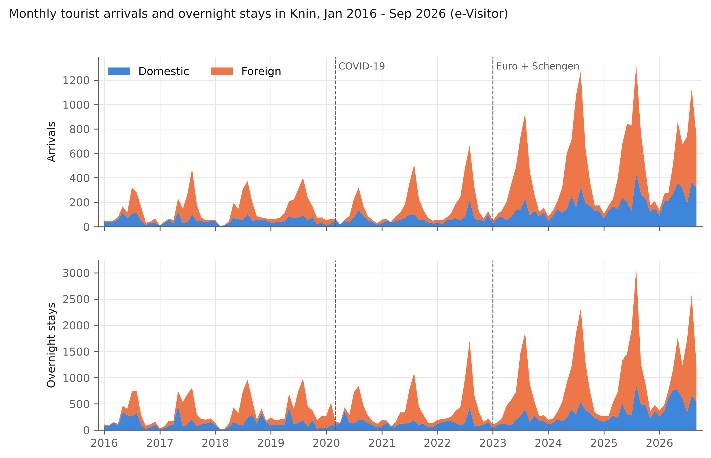
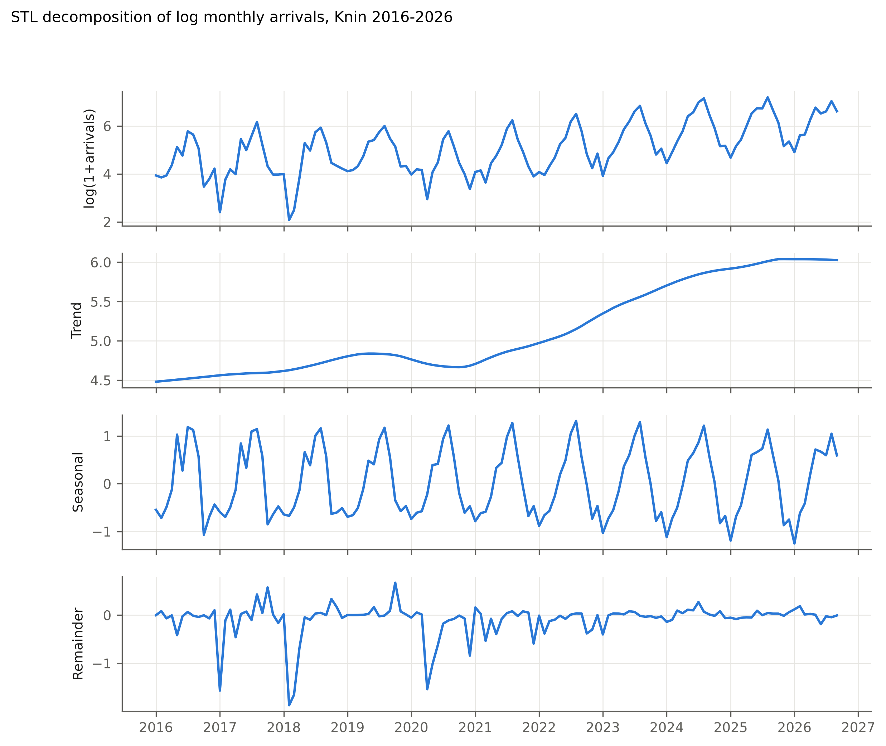
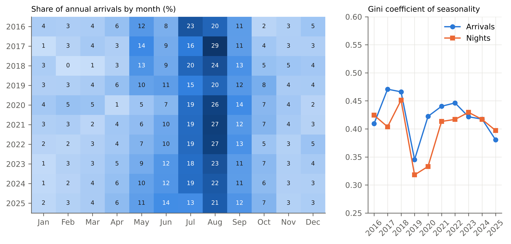
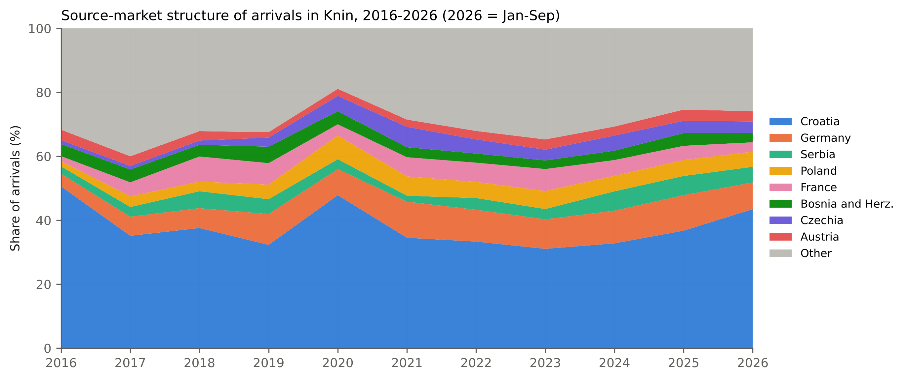
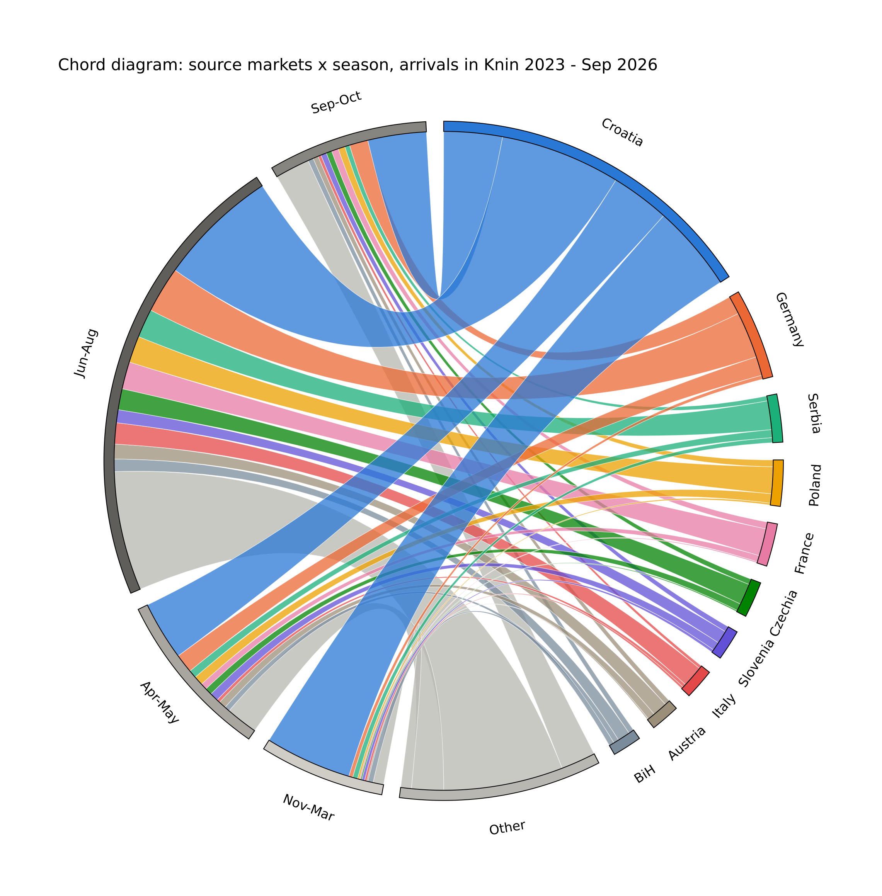
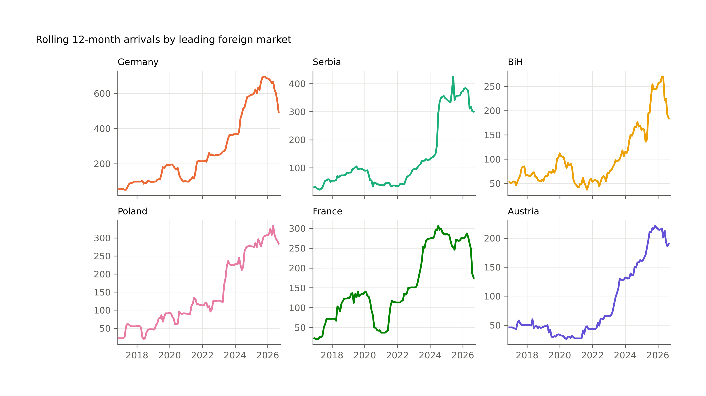
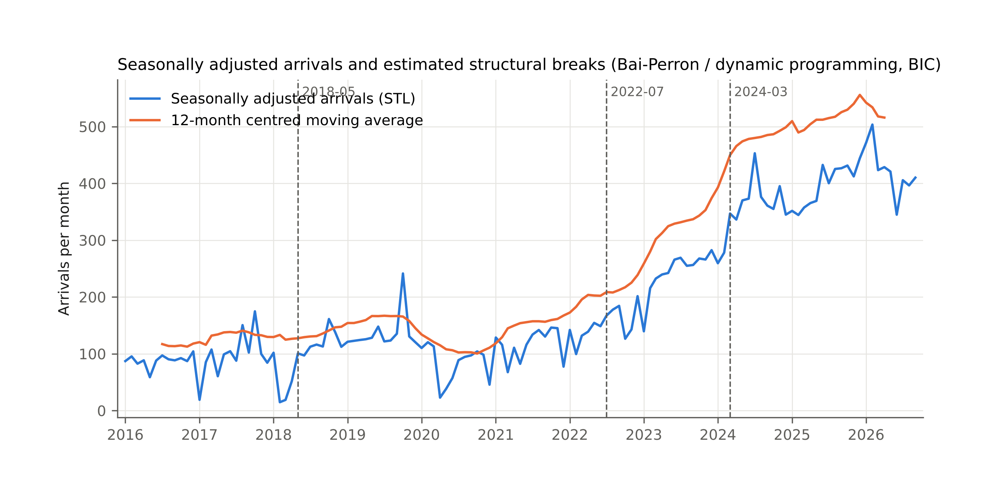
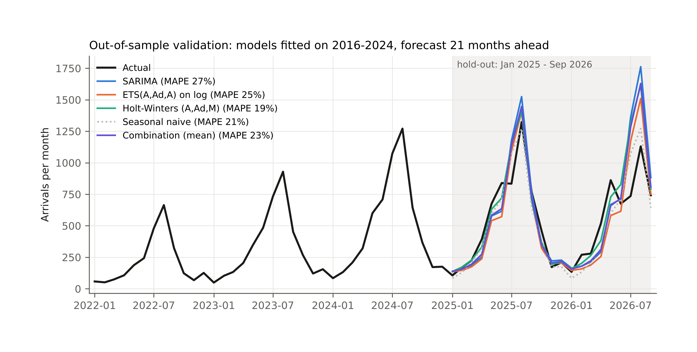
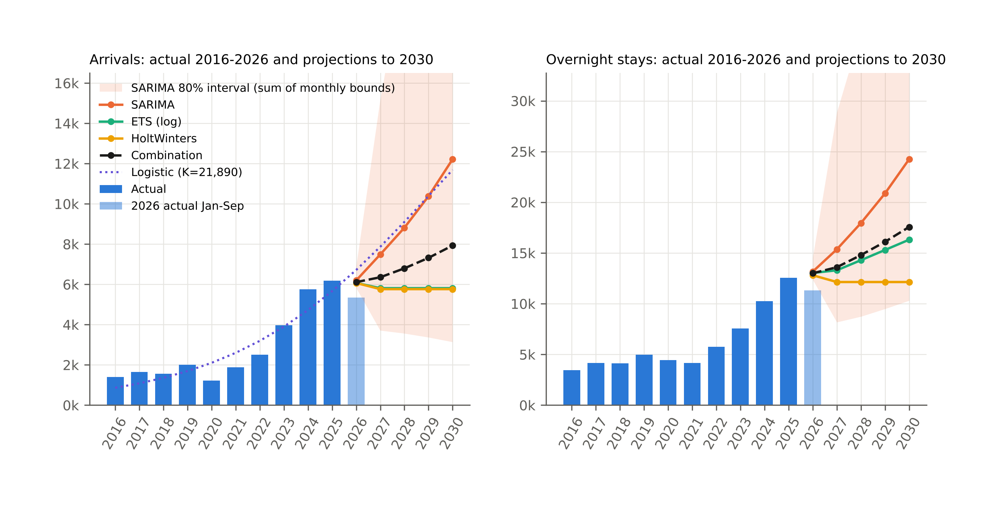
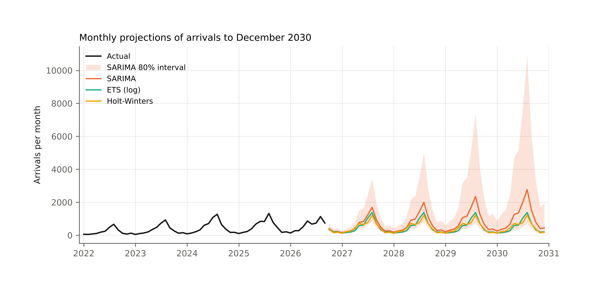

^1^ Veleučilište „Marko Marulić" u Kninu (vuros@veleknin.hr, ORCID 0009-0007-6568-0827)
^2^ Fakultet organizacije i informatike, Sveučilište u Zagrebu, Varaždin

*Napomena: ovo je kontrolna hrvatska verzija engleskog rukopisa, namijenjena provjeri sadržaja. Slike i tablice generirane su iz istih podataka i skripti; natpisi na slikama su na engleskom.*

# Sažetak

U radu se analizira razvoj turizma u Kninu, malom gradu u Dalmatinskoj zagori, na temelju cjelovite mjesečne evidencije nacionalnog sustava e-Visitor od siječnja 2016. do rujna 2026. (129 mjeseci, 75 emitivnih tržišta). Obrađuju se četiri pitanja: koliko je brzo turizam rastao i je li se putanja rasta promijenila nakon pandemije COVID-19; je li rast promijenio sezonski profil; kako se mijenjala struktura emitivnih tržišta; i što podaci govore o razdoblju do 2030. Dolasci turista porasli su s 1.404 u 2016. na 6.178 u 2025. (prosječna godišnja stopa rasta 17,9 %), a noćenja s 3.456 na 12.558 (15,4 %), pri čemu je rast koncentriran u razdoblju 2021. - 2025. (34,5 % godišnje). Procjena strukturnih lomova na desezoniranoj seriji smješta glavnu promjenu režima u 2022. - 2023., a ne u pandemijski šok; postpandemijski trend (32,7 % godišnje) otprilike je dvostruko veći od pretpandemijskog (16,8 %). Sezonalnost mjerena Ginijevim koeficijentom mjesečnih dolazaka kretala se između 0,35 i 0,47 bez značajnog trenda; udio srpnja i kolovoza pao je s 43 % na 35 %, ali je pao i zimski udio, pa se rast prelio u mjesece uz sezonu, a ne u izvansezonsko razdoblje. Udio stranih dolazaka porastao je s 49 % na 63 %, broj aktivnih tržišta s 38 na 59, a Herfindahl-Hirschmanov indeks stranih tržišta ostao je nizak (0,06 - 0,08), s Njemačkom, Srbijom, Poljskom, Francuskom te Bosnom i Hercegovinom kao vodećim stranim tržištima. Prosječni boravak pao je s 2,5 na 2,0 noćenja, što Knin zadržava u kategoriji tranzitne destinacije. Validacija SARIMA, ETS i Holt-Wintersovih modela na 21-mjesečnom izdvojenom uzorku (siječanj 2025. - rujan 2026.) pokazuje da su svi modeli precijenili sezonu 2026., jer je rast u 2026. stao (dolasci siječanj - rujan +0,2 % u odnosu na 2025.). Projekcije do 2030. zato se razilaze: SARIMA koja ekstrapolira trend daje oko 12.000 dolazaka i 24.000 noćenja, prigušeno eksponencijalno izglađivanje plato od oko 5.800 dolazaka i 12.000 - 16.000 noćenja, a kombinacija modela oko 7.900 dolazaka i 17.600 noćenja. U radu se tvrdi da zastoj 2026. označava kraj postpandemijske faze sustizanja i da daljnji rast ovisi o pretvaranju tranzitnih posjetitelja u dulje boravke. Podaci i kod objavljeni su za ponovnu uporabu.

**Ključne riječi:** turistička potražnja, e-Visitor, sezonalnost, Ginijev koeficijent, koncentracija emitivnih tržišta, strukturni lom, SARIMA, eksponencijalno izglađivanje, turizam zaleđa, Hrvatska

# 1. Uvod

Hrvatski turizam koncentriran je na jadranskoj obali, i prostorno i vremenski. Obalne županije ostvaruju više od 90 % noćenja, a ljetni vrh među je najizraženijima u Europi (Duro & Turrión-Prats, 2019; Payne, Nazlioglu & Mervar, 2023). Nacionalne i regionalne strategije godinama navode disperziju potražnje prema zaleđu i izvan sezone kao cilj. Ostvaruju li se ti ciljevi obično se procjenjuje na razini županije ili države, gdje su male destinacije u unutrašnjosti nevidljive u agregatnoj statistici. Ovaj rad promatra jednu takvu destinaciju, grad Knin u Šibensko-kninskoj županiji, tijekom prvog desetljeća nacionalnog sustava e-Visitor.

Knin je grad s oko 11.000 stanovnika, 55 km u unutrašnjosti od Šibenika, na glavnom cestovnom i željezničkom koridoru Zagreb - Split i blizu sjevernog ulaza u Nacionalni park Krka. Turistička ponuda počiva na kninskoj tvrđavi, izvoru Krke, Parku prirode Dinara i blizini nacionalnih parkova Krka i Plitvička jezera. U tipologiji kretanja posjetitelja (Lew & McKercher, 2006; Lue, Crompton & Fesenmaier, 1993) Knin je bio usputna postaja, a ne baza: posjetitelji prolaze na putu prema obali, prenoće jednu ili dvije noći i nastavljaju dalje. Studija prihvatnog kapaciteta Instituta za turizam za Šibensko-kninsku županiju identificirala je klaster zaleđa, kojem Knin pripada, kao klaster s najvećim neiskorištenim potencijalom rasta u županiji (Institut za turizam, 2019). Pitanje koje se ovdje postavlja jest pokazuje li desetljeće 2016. - 2026. da se taj potencijal ostvaruje i je li rast promijenio karakter destinacije.

Empirijsku građu čini cjelovita mjesečna evidencija sustava e-Visitor za područje Turističke zajednice grada Knina, od siječnja 2016., kada je sustav uveden, do rujna 2026. e-Visitor je obvezni nacionalni registar dolazaka i noćenja turista u Hrvatskoj i izvor službene statistike Državnog zavoda za statistiku (Marušić, Kožul & Brozović, 2020). Skup podataka obuhvaća 129 mjesečnih opažanja dolazaka i noćenja po zemlji podrijetla za 75 izvještajnih tržišta. Prema saznanjima autora, nijedna recenzirana studija nije analizirala turizam u Kninu, a malo ih je koristilo desetljeće mjesečnih e-Visitor podataka za jednu malu destinaciju u unutrašnjosti.

Rad daje četiri doprinosa. Prvo, dokumentira rast turizma u Kninu i testira strukturnu promjenu putanje rasta oko pandemije COVID-19 te uvođenja eura i ulaska u schengenski prostor 2023. Drugo, mjeri sezonalnost Ginijevim koeficijentom i srodnim pokazateljima te testira je li rast promijenio sezonski profil. Treće, opisuje strukturu emitivnih tržišta indeksima koncentracije i dijagramima tokova tržište - sezona. Četvrto, izrađuje validirane prognoze i scenarijske projekcije do 2030. i raspravlja zašto se prognostički modeli ne slažu na sadašnjoj prekretnici. Podaci, kod i slike objavljeni su u otvorenom repozitoriju kako bi se analiza mogla ponoviti i proširiti na druge destinacije.

Ostatak rada strukturiran je na sljedeći način. U drugom poglavlju pregledava se literatura o prognoziranju turističke potražnje, mjerenju sezonalnosti, koncentraciji emitivnih tržišta i strukturnim promjenama. Treće poglavlje opisuje podatke i metode. Četvrto poglavlje iznosi rezultate. Peto poglavlje raspravlja nalaze i njihove implikacije. Šesto poglavlje zaključuje.

# 2. Pregled literature

## 2.1 Modeliranje i prognoziranje turističke potražnje

Prognoziranje turističke potražnje zrelo je područje s više preglednih radova (Song & Li, 2008; Wu, Song & Shen, 2017; Song, Qiu & Park, 2019). Dominiraju tri obitelji metoda: modeli vremenskih serija, ekonometrijski modeli s objašnjavajućim varijablama i, u novije vrijeme, metode strojnog učenja i mješovitih frekvencija. Za male destinacije s kratkim mjesečnim serijama i bez lokalnih objašnjavajućih varijabli na mjesečnoj frekvenciji, univarijatni modeli vremenskih serija ostaju praktičan izbor. Natjecanje u prognoziranju turizma Athanasopoulosa, Hyndmana, Songa i Wua (2011) pokazalo je da za mjesečne i kvartalne turističke serije sezonsko eksponencijalno izglađivanje (ETS) i sezonski ARIMA modeli daju dobre rezultate, da je jednostavne sezonske naivne prognoze teško nadmašiti na kratkim horizontima i da su kombinacije prognoza robusne. Ti nalazi motiviraju skup modela koji se ovdje koristi: sezonski ARIMA (Box & Jenkins, 1970), obitelj ETS modela u prostoru stanja (Hyndman, Koehler, Snyder & Grose, 2002; Hyndman & Khandakar, 2008), multiplikativna Holt-Wintersova metoda (Winters, 1960), sezonska naivna metoda kao referentna i jednostavna kombinacija. Točnost prognoza ocjenjuje se mjerama neovisnima o mjernoj jedinici koje preporučuju Hyndman i Koehler (2006). Sezonalnost u turističkim serijama često je bolje tretirati kao stohastičku nego kao determinističku (Kulendran & Wong, 2005), što podupire sezonsko diferenciranje i sezonsko izglađivanje umjesto fiksnih mjesečnih dummy varijabli. Za Hrvatsku su Baldigara i Mamula (2015) te Apergis, Mervar i Payne (2017) prognozirali dolaske sezonskim ARIMA modelima, Tica i Kožić (2015) usporedili su univarijatne i kauzalne modele inozemne potražnje, Gricar, Baldigara i Šugar (2021) ispitali su odrednice koje utječu na prognoze dolazaka, a Mervar i Payne (2007) procijenili su dugoročne elastičnosti inozemne potražnje za hrvatskim destinacijama. Gil-Alana, Mervar i Payne (2015) pokazali su da su hrvatske mjesečne serije izrazito perzistentne, što ide u prilog modelima s jediničnim korijenima i sezonskim diferenciranjem. Sve te studije rade na nacionalnoj ili županijskoj razini; nijedna ne prognozira jednu malu destinaciju.

## 2.2 Mjerenje sezonalnosti

Sezonalnost je najistraživanije strukturno obilježje turističke potražnje (Butler, 1994, 2001; Koenig-Lewis & Bischoff, 2005). Lundtorp (2001) razvrstao je mjere na mjere amplitude (omjer sezonalnosti, udio vrha) i mjere koncentracije (koeficijent varijacije, Ginijev koeficijent). Ginijev koeficijent mjesečnih vrijednosti postao je standardna mjera koncentracije otkako je Fernández-Morales (2003) pokazao da se može dekomponirati po emitivnim tržištima, čime se može kvantificirati doprinos svakog tržišta ukupnoj sezonskoj koncentraciji (Cisneros-Martínez & Fernández-Morales, 2015; Fernández-Morales, Cisneros-Martínez & McCabe, 2016; Duro, 2016). Duro i Turrión-Prats (2019) izračunali su Ginijeve koeficijente za velik skup zemalja i svrstali Hrvatsku među najsezonalnije destinacije u svijetu. Hrvatske studije to su potvrdile na nacionalnoj i županijskoj razini (Kožić, Krešić & Boranić-Živoder, 2013; Mak & Kovač, 2021; Milenkovska Klimoska, 2021), Ružić i Gavrić (2026) svrstali su hrvatske NUTS-2 regije među najsezonalnije na Mediteranu prema panel procjenama Ginijeva koeficijenta za 2020. - 2024., a Payne, Gil-Alana, Mervar i Goenechea (2023) utvrdili su da je pandemija promijenila perzistentnost i sezonalnost serija obalnih županija. Odgovor politike usmjeren je na produljenje sezone zimskim proizvodima (Krstinić Nižić & Šverko Grdić, 2018), agroturizmom (Košak & Lugomer, 2016) i cjelogodišnjim ruralnim doživljajima za domaće posjetitelje (Pranić & Vuković, 2026), a Krešić (2026) pokazao je na cjelogodišnjoj anketi posjetitelja da su izvansezonski posjetitelji barem jednako zadovoljni kao ljetni. Slijede li male destinacije u unutrašnjosti obalni obrazac otvoreno je pitanje koje ovaj rad obrađuje na jednom slučaju.

## 2.3 Struktura emitivnih tržišta

Koncentracija potražnje na malom broju emitivnih tržišta izlaže destinaciju šokovima na tim tržištima. Uobičajena mjera je Herfindahl-Hirschmanov indeks (HHI) tržišnih udjela; Ağazade (2022) te Ağazade, Tükenmez i Uzun (2023) pokazali su za Tursku da koncentracija emitivnih tržišta utječe na razinu i volatilnost turističkih prihoda. Recipročna vrijednost HHI-ja, efektivni broj tržišta, lakše se interpretira. Diverzifikacija tržišta povezana je i sa sezonalnošću, jer različita tržišta putuju u različitim mjesecima (Fernández-Morales i sur., 2016), zbog čega ovaj rad prikazuje tokove tržište - sezona zajedno.

## 2.4 Strukturne promjene, pandemija i institucionalna integracija

Pandemija COVID-19 bila je najveći šok za turizam u poslijeratnom razdoblju (Gössling, Scott & Hall, 2021; Škare, Soriano & Porada-Rochoń, 2021), a oporavak je u različitim destinacijama išao različitim putovima (Fotiadis, Polyzos & Huan, 2021; Zhang, Song, Wen & Liu, 2021; Čorak, Boranić Živoder & Marušić, 2020). Payne, Gil-Alana i Mervar (2022) utvrdili su da su hrvatske turističke serije promijenile perzistentnost nakon pandemije, Payne, Nazlioglu, Mervar i Niroomand (2023) povezali su noćenja turista s neizvjesnošću ekonomske politike tijekom pandemije, Šulc i Fuerst-Bjeliš (2021) opisali su promjenu turističkih putanja u Hrvatskoj, a Mikulić, Keček i Žajdela Hrustek (2023) pokazali su regionalnim input-output modelom da je pandemija jadransku Hrvatsku pogodila znatno jače nego kontinentalnu. Strukturna promjena u vremenskoj seriji testira se Chowovim (1960) testom kada je datum loma poznat, a procjenjuje postupkom Baija i Perrona (1998, 2003) kada nije. Pristupanje Hrvatske Europskoj uniji 2013. imalo je mjerljiv učinak na turizam (Tkalec, 2024); uvođenje eura i ulazak u Schengen 1. siječnja 2023. mogli su imati slične učinke kroz niže transakcijske troškove i ukidanje čekanja na granici (Gil-Pareja, Llorca-Vivero & Martínez-Serrano, 2007; Santana-Gallego, Ledesma-Rodríguez & Pérez-Rodríguez, 2010; Franjić, Jagodič, Božinovski & Jurakić, 2026), ali nijedna studija to još nije kvantificirala za destinaciju. Najbliži dokazi su geografski: Opačić i Banda (2025) dokumentirali su kako je promjena geografskog položaja (Pelješki most i Schengen) promijenila turistički razvoj poluotoka Pelješca, a Wittmann, Gonda, Merza i Pap (2026) pratili su transformaciju pograničnog područja od zatvorene granice do turističke destinacije nakon ulaska u Schengen. Putanje rasta destinacija tumače se i kroz životni ciklus turističkog područja (Butler, 1980), koji su Lundtorp i Wanhill (2001) formalizirali kao logističku krivulju čiji se kapacitet nosivosti može procijeniti iz podataka o dolascima.

## 2.5 Turizam zaleđa u Hrvatskoj

Hrvatski turizam prostorno je koncentriran na obali (Kranjčević & Hajdinjak, 2019), a regionalna konvergencija obalnih i kontinentalnih županija bila je spora (Payne, Nazlioglu & Mervar, 2023). Studija o Dalmatinskoj zagori malo je. Protega, Božić i Lučić (2007) ispitali su učinak autoceste A1 na turizam u Šibensko-kninskoj županiji tijekom njezine izgradnje i utvrdili neujednačene učinke po destinacijama. Radeljak Kaufmann (2020) analizirala je ruralni turizam u okolici Nacionalnog parka Krka i utvrdila učinke prelijevanja na okolne općine, a Telbisz, Šulc, Mari i Radeljak Kaufmann (2022) anketirali su posjetitelje NP Krka, od kojih su većina turisti s obale na jednodnevnom izletu, što je bazen iz kojeg gradovi u zaleđu poput Knina crpe noćenja. Petrić, Mandić i Mikulić (2025) predložili su kulturna turistička sela kao razvojni model Dalmatinske zagore, a Cerjak, Galić i Antoniak (2026) analizirali su kulturnu baštinu kao pokretač ruralnog turizma u Šibensko-kninskoj županiji. Opačić, Klarić, Beroš i Boranić Živoder (2022) izradili su indeks turističkog razvoja za sve hrvatske jedinice lokalne samouprave i smjestili gradove u unutrašnjosti poput Knina u najniže kategorije. Tomljenović i Kunst (2014) raspravljali su o diverzifikaciji od sunca i mora prema kulturnom turizmu u Dalmaciji, a Koens, Postma i Papp (2018) o disperziji posjetitelja iz zasićenih žarišta kao odgovoru na prekomjerni turizam. Ovaj rad dodaje toj tankoj literaturi kvantitativnu, desetogodišnju studiju slučaja.

# 3. Podaci i metode

## 3.1 Podaci

Podaci su mjesečni izvještaji izvezeni iz sustava e-Visitor od strane Turističke zajednice grada Knina za područje „Šibensko-kninska - Knin", svi tipovi smještaja, samo turisti (izletnici isključeni), sve vrste naplate (komercijalni po noćenju, komercijalni paušalno, kampovi, nekomercijalni i oslobođeni). Svaki mjesečni izvještaj navodi dolaske, noćenja i broj turista po zemlji podrijetla, prema klasifikaciji zemalja Državnog zavoda za statistiku (75 izvještajnih zemalja i rezidualnih skupina). Izvještaji pokrivaju razdoblje siječanj 2016. - rujan 2026. (129 mjeseci); godišnji izvještaji za 2016. - 2025. korišteni su za provjeru mjesečnih zbrojeva. Izvještaji su izvezeni u rujnu 2026., pa su podaci za 2016. - 2025. konačni, a podaci za 2026. odražavaju stanje registra krajem rujna 2026.

Uočena su i riješena dva problema s podacima. Prvo, nekoliko datoteka bilo je krivo označeno (primjerice, datoteka nazvana „svibanj 2017." sadržavala je izvoz za travanj 2017.); mjesec svake datoteke zato je preuzet iz datumskih parametara pohranjenih unutar datoteke, a ne iz imena datoteke. Drugo, za svibanj 2017. nije postojao ispravan izvoz; vrijednosti za svibanj 2017. rekonstruirane su za svaku zemlju kao razlika godišnjeg izvještaja za 2017. i zbroja ostalih jedanaest mjeseci, što točno reproducira godišnje zbrojeve. Mjesečni zbrojevi svih ostalih godina podudaraju se s godišnjim izvještajima.

e-Visitor je administrativni registar. Marušić i sur. (2020) raspravljaju o njegovim ograničenjima: nekomercijalni boravci (vikendice, posjeti prijateljima i rodbini) nedovoljno su registrirani, a usklađenost se poboljšavala u prvim godinama nakon uvođenja, pa 2016. može biti blago podcijenjena u odnosu na kasnije godine. Ta ograničenja više utječu na razine nego na stope rasta i sezonske obrasce.

## 3.2 Deskriptivni pokazatelji

Tabeliraju se godišnji dolasci, noćenja, udio stranih turista i prosječno trajanje boravka (ALOS, noćenja po dolasku). Rast se sažima prosječnim godišnjim stopama rasta (CAGR). Za 2026. dostupno je samo razdoblje siječanj - rujan, pa se 2026. uspoređuje s istim mjesecima 2025.

## 3.3 Dekompozicija i sezonalnost

Mjesečni dolasci i noćenja logaritmirani su (log(1+y)) i dekomponirani robusnim STL postupkom (Cleveland, Cleveland, McRae & Terpenning, 1990) sa sezonskim periodom 12. Jačina trenda i sezonalnosti izračunata je kao F_T = 1 - Var(R)/Var(T+R) i F_S = 1 - Var(R)/Var(S+R), gdje su T, S i R komponente trenda, sezone i ostatka (Hyndman & Athanasopoulos, 2021). Za svaku potpunu godinu sezonalnost je mjerena Ginijevim koeficijentom dvanaest mjesečnih vrijednosti (Fernández-Morales, 2003; Lundtorp, 2001), omjerom sezonalnosti (vršni mjesec prema prosječnom mjesecu), koeficijentom varijacije, udjelom srpnja i kolovoza te udjelom studenog - ožujka. Vremenski trend Ginijeva koeficijenta testiran je Kendallovim tau i običnim najmanjim kvadratima.

## 3.4 Struktura emitivnih tržišta

Za svaku godinu izračunat je HHI dolazaka po zemljama za sva tržišta i samo za strana tržišta, zajedno s efektivnim brojem tržišta (1/HHI), udjelom pet najvećih tržišta i brojem tržišta s barem jednim dolaskom. Tokovi tržište - sezona za 2023. - 2026. vizualizirani su chord dijagramom koji povezuje deset najvećih tržišta (i rezidualnu skupinu) s četiri sezone (studeni - ožujak, travanj - svibanj, lipanj - kolovoz, rujan - listopad).

## 3.5 Strukturne promjene

Strukturni lomovi procijenjeni su na desezoniranim logaritmiranim dolascima (log serija umanjena za STL sezonsku komponentu). Datumi lomova za jedan do tri loma u sredini procijenjeni su dinamičkim programiranjem s minimalnom duljinom segmenta 18 mjeseci, što je algoritam egzaktnog rješenja Baija i Perrona (2003); broj lomova odabran je Bayesovim informacijskim kriterijem. Chowovi (1960) testovi promjene odsječka i nagiba linearnog trenda izračunati su na tri a priori datuma: ožujak 2020. (pandemija), lipanj 2021. (ponovno otvaranje) i siječanj 2023. (euro i Schengen). Pretpandemijska i postpandemijska stopa rasta trenda procijenjene su regresijom desezoniranih logaritmiranih dolazaka na vrijeme za 2016. - 2019. i za lipanj 2021. - rujan 2026. Stacionarnost je ispitana proširenim Dickey-Fullerovim i KPSS testom.

## 3.6 Prognostički modeli i validacija

Na mjesečne dolaske i noćenja prilagođena su četiri modela: (i) sezonski ARIMA(p,1,q)(P,1,Q)~12~ model na logaritamskoj skali, s redovima p, q od 0 do 3 i P, Q od 0 do 2 odabranima Akaikeovim informacijskim kriterijem uz ograničenja stacionarnosti i invertibilnosti, te rezidualima provjerenima Ljung-Boxovim testom; (ii) ETS(A,A~d~,A) model na logaritamskoj skali, tj. aditivni prigušeni trend i aditivna sezonalnost, što odgovara multiplikativnoj sezonalnosti na izvornoj skali; (iii) Holt-Wintersova metoda s prigušenim aditivnim trendom i multiplikativnom sezonalnošću na izvornoj skali; (iv) sezonska naivna metoda kao referentna; i (v) aritmetička sredina modela (i) do (iii) kao kombinacija. Modeli su procijenjeni na razdoblju siječanj 2016. - prosinac 2024. i ocijenjeni na 21-mjesečnom izdvojenom uzorku siječanj 2025. - rujan 2026. srednjom apsolutnom postotnom pogreškom (MAPE), korijenom srednje kvadratne pogreške (RMSE), srednjom apsolutnom skaliranom pogreškom (MASE, skaliranom sezonskom naivnom pogreškom unutar uzorka) i kumulativnom pristranošću u postocima (Hyndman & Koehler, 2006). Konačne projekcije izrađene su ponovnom procjenom svakog modela na cijelom uzorku do rujna 2026. i prognozom 51 mjesec unaprijed do prosinca 2030.; iskazan je 80-postotni interval predviđanja SARIMA modela. Godišnji zbrojevi za 2026. kombiniraju opažene vrijednosti siječanj - rujan s prognozama za listopad - prosinac. Kao dopunski dugoročni scenarij, logistička krivulja N(t) = K/(1 + exp(-r(t - t~0~))) prilagođena je godišnjim dolascima 2016. - 2026. nelinearnim najmanjim kvadratima (Lundtorp & Wanhill, 2001).

Svi izračuni provedeni su u Pythonu 3.13 s paketima pandas, statsmodels 0.15, ruptures 1.1, SciPy i pyCirclize. Kod, konsolidirani skup podataka i svi rezultati dostupni su u pratećem repozitoriju.

# 4. Rezultati

## 4.1 Rast 2016. - 2026.

Tablica 1 i slika 1 sažimaju desetljeće. Dolasci su porasli s 1.404 u 2016. na 6.178 u 2025., noćenja s 3.456 na 12.558. Prosječne godišnje stope rasta za 2016. - 2025. iznose 17,9 % za dolaske i 15,4 % za noćenja, ali rast nije bio ujednačen. Od 2016. do 2019. dolasci su ukupno porasli 43 %; 2020. donijela je pad dolazaka od 39 %, ali pad noćenja od samo 11 %, jer je malobrojnih turista koji su došli boravak bio dulji (ALOS 3,6 noćenja). Godine 2021. - 2025. bile su razdoblje brze ekspanzije: dolasci su rasli 34,5 % godišnje, a noćenja 31,8 % godišnje, s najvećim godišnjim povećanjima 2023. (+59 % dolazaka) i 2024. (+45 %). Rast je usporio na +7 % dolazaka i +23 % noćenja u 2025., a 2026. je stao: dolasci u siječnju - rujnu 2026. iznosili su 5.346, 0,2 % više nego u istim mjesecima 2025., a noćenja 11.328, 4,6 % više.

Tablica 1. Godišnji dolasci i noćenja turista u Kninu, 2016. - 2026. (e-Visitor)

| Godina | Dolasci | Noćenja | Udio stranih u dolascima (%) | ALOS (noćenja) | Dolasci g/g (%) | Noćenja g/g (%) |
|----------------------|--------:|--------:|--------:|--------:|--------:|--------:|
| 2016. | 1.404 | 3.456 | 49,4 | 2,46 | - | - |
| 2017. | 1.645 | 4.177 | 64,9 | 2,54 | +17,2 | +20,9 |
| 2018. | 1.565 | 4.129 | 62,4 | 2,64 | -4,9 | -1,1 |
| 2019. | 2.003 | 4.964 | 67,7 | 2,48 | +28,0 | +20,2 |
| 2020. | 1.227 | 4.432 | 52,2 | 3,61 | -38,7 | -10,7 |
| 2021. | 1.886 | 4.157 | 65,5 | 2,20 | +53,7 | -6,2 |
| 2022. | 2.503 | 5.755 | 66,7 | 2,30 | +32,7 | +38,4 |
| 2023. | 3.977 | 7.566 | 68,9 | 1,90 | +58,9 | +31,5 |
| 2024. | 5.758 | 10.236 | 67,2 | 1,78 | +44,8 | +35,3 |
| 2025. | 6.178 | 12.558 | 63,3 | 2,03 | +7,3 | +22,7 |
| 2026. (sij. - ruj.) | 5.346 | 11.328 | 56,5 | 2,12 | +0,2* | +4,6* |

\* Siječanj - rujan 2026. u odnosu na siječanj - rujan 2025. ALOS = prosječno trajanje boravka. Izvor: izračun autora iz e-Visitor podataka.

Sastav potražnje promijenio se na dva načina. Udio stranih dolazaka porastao je s 49 % u 2016. na plato od 63 - 69 % u 2019. - 2025., a vratio se na 57 % u siječnju - rujnu 2026., jer su domaći dolasci nastavili rasti (+31 % godišnje, domaća noćenja +48 %), dok su strani dolasci pali (-15 %). Prosječno trajanje boravka palo je s 2,5 - 2,6 noćenja u 2016. - 2018. na 1,8 - 2,0 noćenja u 2023. - 2025., uz djelomični oporavak na 2,1 noćenje u 2026. Rast je stoga nosilo više kraćih posjeta.

## 4.2 Komponente trenda i sezone

STL dekompozicija (slika 2) razdvaja snažan trend (F_T = 0,75 za dolaske, 0,67 za noćenja) od snažne i stabilne sezonske komponente (F_S = 0,82 i 0,81). Sezonska komponenta implicira omjer vrha i dna od oko 13 za dolaske, što znači da je razina kolovoza tipično trinaest puta veća od razine veljače nakon uklanjanja trenda. Komponenta trenda ravna je od 2016. do 2019., pada 2020. i strmo raste od sredine 2021. do 2025., pri čemu anualizirani nagib trenda za lipanj 2021. - rujan 2026. iznosi 29,5 %. Komponenta ostatka prikazuje pandemijske mjesece travanj - svibanj 2020. kao najveće negativne odstupanja i bez usporedivih odstupanja poslije.

Testovi jediničnog korijena potvrđuju da je logaritmirana serija nestacionarna u razinama (ADF s trendom: p = 0,68; KPSS: p = 0,10) i stacionarna nakon jednog običnog i jednog sezonskog diferenciranja (ADF: p < 0,001), što podupire strukturu diferenciranja (1,1) u SARIMA modelima.

## 4.3 Sezonalnost

Tablica 2 i slika 3 prikazuju pokazatelje sezonalnosti. Ginijev koeficijent mjesečnih dolazaka kretao se od 0,345 (2019.) do 0,471 (2017.), s 0,409 u 2016. i 0,381 u 2025. Ni Kendallov tau (-0,29, p = 0,29) ni OLS nagib (-0,003 godišnje, p = 0,47) ne ukazuju na značajan trend. Za noćenja koeficijent se kretao od 0,424 do 0,397 (tau = 0,02, p = 1,00). Udio srpnja i kolovoza u godišnjim dolascima pao je s 43 % u 2016. i 46 % u 2021. - 2022. na 35 % u 2025., a omjer sezonalnosti pao je s 3,2 u 2021. - 2022. na 2,6 u 2025. Toplinska karta na slici 3 pokazuje kamo je otišao udio vrha: u svibanj, lipanj i rujan, od kojih je svaki dobio dva do četiri postotna boda. Zimski udio (studeni - ožujak) nije porastao; pao je s 18 % u 2016. na 14 % u 2025., a zimski dolasci rasli su sporije (CAGR 14,8 %) od dolazaka u lipnju - rujnu (17,6 %).

Tablica 2. Pokazatelji sezonalnosti mjesečnih dolazaka, potpune godine 2016. - 2025.

| Godina | Gini | Omjer sezonalnosti | KV | Udio srp. - kol. (%) | Udio lip. - ruj. (%) | Udio stu. - ožu. (%) |
|----------------------|--------:|--------:|--------:|--------:|--------:|--------:|
| 2016. | 0,409 | 2,74 | 0,83 | 42,7 | 62,2 | 18,2 |
| 2017. | 0,471 | 3,46 | 0,98 | 44,9 | 64,8 | 13,4 |
| 2018. | 0,466 | 2,86 | 0,90 | 43,6 | 65,6 | 13,6 |
| 2019. | 0,345 | 2,40 | 0,66 | 35,4 | 58,3 | 17,2 |
| 2020. | 0,422 | 3,15 | 0,89 | 44,8 | 65,7 | 21,3 |
| 2021. | 0,440 | 3,24 | 0,92 | 45,9 | 67,5 | 14,7 |
| 2022. | 0,446 | 3,18 | 0,92 | 45,7 | 68,3 | 15,1 |
| 2023. | 0,422 | 2,80 | 0,83 | 41,8 | 65,3 | 14,1 |
| 2024. | 0,417 | 2,65 | 0,81 | 40,7 | 64,2 | 13,4 |
| 2025. | 0,381 | 2,57 | 0,73 | 34,9 | 60,9 | 14,3 |

Omjer sezonalnosti = vršni mjesec / prosječni mjesec; KV = koeficijent varijacije. Izvor: izračun autora.

Domaća potražnja znatno je manje sezonalna od strane: Ginijev koeficijent domaćih dolazaka iznosio je 0,23 - 0,32 u svim godinama osim 2020. (0,37), naspram 0,42 - 0,61 za strane dolaske. Domaći posjetitelji putuju u Knin tijekom cijele godine, često zbog događanja, obiteljskih i poslovnih razloga, dok su strani posjetitelji koncentrirani u ljetnoj tranzitnoj sezoni. Djelomični povratak domaće potražnje 2026. u skladu je s blagim smanjenjem sezonalnosti.

## 4.4 Struktura emitivnih tržišta

Tablica 3 navodi petnaest najvećih tržišta. Hrvatska je ostala najveće pojedinačno tržište, ali joj je udio pao s 51 % u 2016. na 37 % u 2025. Njemačka je porasla s 4 % na 11 % i od 2019. postala najveće strano tržište. Srbija (6 %), Poljska (5 %), Francuska (4,5 %), Bosna i Hercegovina (4 %), Češka (3,8 %), Austrija (3,5 %), Italija (3,1 %) i Slovenija (2,8 %) upotpunjuju prvih deset. Između 2019. i 2025. najbrže rastuća tržišta među prvih deset bila su Austrija (CAGR 36 %), Slovenija (33 %), Češka (27 %), Srbija (26 %), Njemačka (24 %) i Hrvatska (23 %), dok su Francuska (13 %), Italija (12 %) i Ujedinjena Kraljevina (5 %) rasle sporije. Tržišta koja su 2016. bila istaknuta zbog pojedinačnih organiziranih skupina (Rumunjska, Letonija, Bjelorusija) nestala su. Prosječno trajanje boravka znatno se razlikuje po tržištima: srpski posjetitelji ostajali su 2025. 3,7 noćenja, posjetitelji iz Bosne i Hercegovine 2,4 i iz Sjedinjenih Država 2,4, dok su talijanski (1,2), češki (1,4) i slovenski (1,4) posjetitelji bili gotovo čisti tranzitni promet.

Tablica 3. Petnaest najvećih emitivnih tržišta prema dolascima, 2016. - 2025.

| Tržište | 2016. | 2019. | 2022. | 2025. | Udio 2016. (%) | Udio 2025. (%) | CAGR 2019. - 2025. (%) | ALOS 2025. |
|----------------------|--------:|--------:|--------:|--------:|--------:|--------:|--------:|--------:|
| Hrvatska | 710 | 647 | 834 | 2.270 | 50,6 | 36,7 | 23,3 | 1,93 |
| Njemačka | 56 | 193 | 249 | 686 | 4,0 | 11,1 | 23,5 | 1,85 |
| Srbija | 32 | 93 | 92 | 370 | 2,3 | 6,0 | 25,9 | 3,74 |
| Poljska | 22 | 91 | 126 | 307 | 1,6 | 5,0 | 22,5 | 1,78 |
| Francuska | 23 | 135 | 151 | 276 | 1,6 | 4,5 | 12,7 | 1,54 |
| Bosna i Hercegovina | 53 | 103 | 71 | 245 | 3,8 | 4,0 | 15,5 | 2,39 |
| Češka | 17 | 57 | 111 | 237 | 1,2 | 3,8 | 26,8 | 1,41 |
| Austrija | 46 | 34 | 66 | 218 | 3,3 | 3,5 | 36,3 | 1,91 |
| Italija | 44 | 95 | 146 | 189 | 3,1 | 3,1 | 12,1 | 1,16 |
| Slovenija | 25 | 32 | 57 | 176 | 1,8 | 2,8 | 32,9 | 1,43 |
| Nizozemska | 16 | 51 | 90 | 111 | 1,1 | 1,8 | 13,8 | 2,06 |
| Ujedinjena Kraljevina | 26 | 72 | 45 | 98 | 1,9 | 1,6 | 5,3 | 1,86 |
| SAD | 10 | 22 | 40 | 91 | 0,7 | 1,5 | 26,7 | 2,36 |
| Švicarska | 25 | 22 | 52 | 73 | 1,8 | 1,2 | 22,1 | 1,49 |
| Mađarska | 5 | 27 | 20 | 66 | 0,4 | 1,1 | 16,1 | 1,55 |

Izvor: izračun autora iz e-Visitor podataka.

Indeksi koncentracije (tablica 4) pokazuju diverzificiranu stranu potražnju. HHI po svim tržištima pao je s 0,272 u 2016., kada je Hrvatska dominirala, na 0,12 - 0,16 u 2022. - 2025., a efektivni broj tržišta porastao je s 3,7 na 6 - 8. Samo među stranim tržištima HHI je tijekom cijelog desetljeća ostao između 0,058 i 0,082, što odgovara 12 - 17 efektivnih stranih tržišta, i nije pokazivao trend (Kendallov tau = 0,16, p = 0,60). Udio pet najvećih tržišta pao je sa 71 % na 57 - 63 %, a broj tržišta s barem jednim dolaskom porastao je s 38 na 59 - 60. Knin stoga ne ovisi ni o jednom pojedinačnom stranom tržištu; rizik u njegovoj tržišnoj strukturi leži u ovisnosti o ljetnom tranzitnom prometu iz Srednje Europe, a ne u koncentraciji po zemljama.

Tablica 4. Koncentracija emitivnih tržišta dolazaka, 2016. - 2026.

| Godina | HHI sva tržišta | HHI strana tržišta | Efektivni broj stranih tržišta | Udio top 5 (%) | Tržišta s dolascima > 0 |
|----------------------|--------:|--------:|--------:|--------:|--------:|
| 2016. | 0,272 | 0,066 | 15,1 | 70,6 | 38 |
| 2017. | 0,148 | 0,058 | 17,4 | 59,0 | 46 |
| 2018. | 0,164 | 0,058 | 17,3 | 61,6 | 44 |
| 2019. | 0,133 | 0,063 | 15,8 | 58,6 | 50 |
| 2020. | 0,251 | 0,082 | 12,2 | 72,8 | 40 |
| 2021. | 0,151 | 0,075 | 13,4 | 64,2 | 51 |
| 2022. | 0,139 | 0,064 | 15,7 | 60,2 | 50 |
| 2023. | 0,124 | 0,058 | 17,4 | 57,3 | 60 |
| 2024. | 0,136 | 0,063 | 15,8 | 58,8 | 53 |
| 2025. | 0,163 | 0,070 | 14,2 | 63,3 | 59 |
| 2026. (sij. - ruj.) | 0,209 | 0,063 | 16,0 | 65,2 | 59 |

Izvor: izračun autora.

Chord dijagram na slici 5 povezuje deset najvećih tržišta s četiri sezone za razdoblje 2023. - rujan 2026. Hrvatska potražnja raspoređena je po svim sezonama, pri čemu je pojas studeni - ožujak (2.062 dolaska) gotovo jednako velik kao pojas lipanj - kolovoz (2.863). Svakim stranim tržištem dominira lipanj - kolovoz: Njemačka šalje 53 % svojih dolazaka u ta tri mjeseca, Francuska 65 %, Italija 71 %, Poljska 60 %, a Srbija 62 %. Predsezonu i posezonu opslužuju uglavnom Njemačka, Poljska, Češka, Austrija i Slovenija u travnju - svibnju te Njemačka i rezidualna skupina u rujnu - listopadu. Zimska strana potražnja zanemariva je za sva tržišta osim Bosne i Hercegovine i Srbije, čiji zimski dolasci odražavaju obiteljske i poslovne veze, a ne turizam u užem smislu.

Slika 6 prikazuje pomični 12-mjesečni zbroj dolazaka za šest najvećih stranih tržišta. Svih šest ima isti oblik: ravno ili sporo rastuće do 2019., pad 2020. - 2021., strm rast od 2022. do 2024. - 2025. i plato ili pad 2026. U siječnju - rujnu 2026. svih šest tržišta bilo je ispod istih mjeseci 2025.: Njemačka za 30 %, Francuska za 39 %, Bosna i Hercegovina za 28 %, Srbija za 21 %, Austrija za 14 % i Poljska za 8 %. Od većih tržišta rasle su samo Hrvatska (+31 %), Slovenija (+30 %) i Nizozemska (+11 %).

## 4.5 Strukturne promjene

Procjena lomova u sredini desezoniranih logaritmiranih dolazaka dinamičkim programiranjem (slika 7) daje jedan lom u veljači 2023. kada je dopušten jedan lom, lomove u svibnju 2018. i veljači 2023. kada su dopuštena dva, te lomove u svibnju 2018., srpnju 2022. i ožujku 2024. kada su dopuštena tri. BIC blago favorizira tri loma u odnosu na dva (-227,3 naspram -225,2), a oba snažno u odnosu na nijedan (-82,9). U svim specifikacijama dominantna promjena režima smještena je u 2022. - 2023., a ne u 2020. Pandemija se pojavljuje kao privremeni pomak razine koji se apsorbira unutar segmenta, jer se serija do sredine 2021. vratila na razinu iz 2019., što je u skladu s nalazom Mikulića, Keček i Žajdele Hrustek (2023) da je kontinentalna Hrvatska bila pogođena znatno manje od obale; promjena režima koja je važna jest ubrzanje koje je počelo sredinom 2022. i trajalo do početka 2024., nakon čega se razina stabilizirala.

Chowovi testovi odbacuju stabilnost parametara na sva tri a priori datuma: ožujak 2020. (F = 28,1, p < 0,001), lipanj 2021. (F = 18,4, p < 0,001) i siječanj 2023. (F = 17,9, p < 0,001). Pretpandemijski trend, procijenjen na 2016. - 2019., iznosio je 16,8 % godišnje; postpandemijski trend, procijenjen na lipanj 2021. - rujan 2026., iznosio je 32,7 % godišnje (standardna pogreška 1,5 postotnih bodova). Postpandemijska putanja rasta stoga nije povratak na pretpandemijski trend nego strmija putanja, što je u skladu s procjenama lomova. Podaci ne mogu razdvojiti učinak uvođenja eura i ulaska u Schengen od općeg postpandemijskog sustizanja hrvatskog i europskog turizma, jer su se oba dogodila u istom razdoblju; o tome se raspravlja u petom poglavlju.

## 4.6 Prognostički modeli i validacija izvan uzorka

AIC je odabrao SARIMA(0,1,2)(0,1,1)~12~ model za logaritmirane dolaske (AIC 136,7; Ljung-Box p = 0,84 na pomaku 12 i 0,33 na pomaku 24) i SARIMA(1,1,1)(1,1,1)~12~ model za logaritmirana noćenja (AIC 138,4; Ljung-Box p = 0,28 i 0,07). Oba su bliska airline modelu, bez dokaza preostale autokorelacije. ETS modeli na logaritamskoj skali procijenili su parametar izglađivanja razine 0,34 (dolasci) i 0,31 (noćenja), parametar izglađivanja trenda nula i parametar prigušenja 0,995, što znači da je trend fiksiran na procijenjenu vrijednost i vrlo sporo prigušen.

Tablica 5 iznosi točnost na 21-mjesečnom izdvojenom uzorku. Za dolaske je Holt-Wintersov model imao najniži MAPE (18,9 %), sezonska naivna metoda najniži RMSE i MASE (1,50), a ETS model najmanju kumulativnu pristranost (-3,6 %). Za noćenja je ETS model imao najniži MAPE (24,8 %), a sezonska naivna metoda ponovno najniži MASE (1,84); svi modeli podcijenili su noćenja za 20 - 36 %, jer je sezona 2025. donijela 23-postotni porast noćenja koji nijedan model prilagođen na 2016. - 2024. nije predvidio. Sve vrijednosti MASE veće su od jedan, što je očekivano za 21-mjesečni horizont (MASE se skalira jednokoračnim pogreškama unutar uzorka), ali odražava i prekretnicu 2026.: kako pokazuje slika 8, svaki model, uključujući sezonsku naivnu metodu, precijenio je lipanj - kolovoz 2026., kada su dolasci pali 12 - 20 % ispod istih mjeseci 2025., nakon što je siječanj - svibanj 2026. bio 24 - 56 % iznad 2025. Kombinacija nije nadmašila najbolji pojedinačni model, ali nikad nije bila najgora i imala je najmanju apsolutnu pristranost za dolaske među trendovskim modelima.

Tablica 5. Točnost prognoza izvan uzorka, izdvojeni uzorak siječanj 2025. - rujan 2026. (21 mjesec)

| Model | Dolasci MAPE (%) | Dolasci RMSE | Dolasci MASE | Dolasci pristranost (%) | Noćenja MAPE (%) | Noćenja RMSE | Noćenja MASE | Noćenja pristranost (%) |
|----------------------|--------:|--------:|--------:|--------:|--------:|--------:|--------:|--------:|
| SARIMA (log) | 26,9 | 236 | 2,23 | +7,8 | 27,0 | 371 | 2,15 | -24,0 |
| ETS(A,A~d~,A) (log) | 24,8 | 185 | 1,94 | -3,6 | 24,8 | 347 | 1,99 | -21,0 |
| Holt-Winters (A,A~d~,M) | 18,9 | 192 | 1,67 | +8,8 | 35,2 | 540 | 3,19 | -36,4 |
| Sezonska naivna | 21,0 | 137 | 1,50 | -6,3 | 25,3 | 342 | 1,84 | -20,0 |
| Kombinacija (sredina tri modela) | 23,1 | 200 | 1,92 | +4,3 | 27,1 | 406 | 2,32 | -27,1 |

Pristranost = (zbroj prognoza - zbroj ostvarenja) / zbroj ostvarenja. Izvor: izračun autora.

## 4.7 Projekcije do 2030.

Tablica 6 te slike 9 i 10 prikazuju projekcije modela ponovno procijenjenih na cijelom uzorku do rujna 2026. Za cijelu 2026. modeli se slažu: 6.100 - 6.200 dolazaka (0 do +1 % u odnosu na 2025.) i 13.000 - 13.200 noćenja (+4 do +5 %). Nakon 2026. razilaze se. SARIMA modeli, koji ekstrapoliraju prosječni rast diferencirane serije tijekom cijelog uzorka, projiciraju 12.200 dolazaka i 24.200 noćenja u 2030., što bi zahtijevalo povratak na oko 18 % godišnjeg rasta. ETS i Holt-Wintersovi modeli s prigušenim trendom, čiji je procijenjeni trend na kraju uzorka blizu nule, projiciraju plato od 5.800 dolazaka i 12.100 - 16.300 noćenja. Kombinacija daje 7.900 dolazaka i 17.600 noćenja u 2030., što odgovara godišnjem rastu od oko 6,5 % za dolaske i 7,5 % za noćenja od 2026. Interval od 80 % SARIMA modela za 2030. (3.100 do 47.700 dolazaka, dobiven zbrajanjem mjesečnih granica i stoga konzervativan) ilustrira neizvjesnost četverogodišnjeg horizonta za seriju ove veličine.

Tablica 6. Godišnje projekcije dolazaka i noćenja do 2030.

| Godina | Dolasci SARIMA | Dolasci ETS (log) | Dolasci Holt-Winters | Dolasci kombinacija | Noćenja SARIMA | Noćenja ETS (log) | Noćenja Holt-Winters | Noćenja kombinacija |
|----------------------|--------:|--------:|--------:|--------:|--------:|--------:|--------:|--------:|
| 2026.* | 6.198 | 6.073 | 6.068 | 6.113 | 13.165 | 13.033 | 12.810 | 13.003 |
| 2027. | 7.490 | 5.812 | 5.764 | 6.355 | 15.361 | 13.296 | 12.139 | 13.599 |
| 2028. | 8.818 | 5.812 | 5.764 | 6.798 | 17.952 | 14.293 | 12.139 | 14.795 |
| 2029. | 10.380 | 5.812 | 5.764 | 7.318 | 20.879 | 15.300 | 12.139 | 16.106 |
| 2030. | 12.219 | 5.812 | 5.764 | 7.931 | 24.247 | 16.312 | 12.139 | 17.566 |

\* Opaženo siječanj - rujan plus prognoza listopad - prosinac. Izvor: izračun autora.

Logistička krivulja prilagođena godišnjim dolascima daje kapacitet nosivosti K od oko 21.900 dolazaka s točkom infleksije 2029., ali je standardna pogreška K (50.300) veća od same procjene. S deset potpunih godina i točkom infleksije koja još nije prijeđena, kapacitet nosivosti nije identificiran iz podataka; logistička prilagodba iskazana je samo kako bi se pokazalo da je opažena putanja u skladu s ranom fazom krivulje životnog ciklusa, a ne kako bi se predvidio njezin strop.

# 5. Rasprava

## 5.1 Rast i njegovi pokretači

Desetljeće se dijeli na tri faze: spor rast do 2019. (oko 17 % godišnje s vrlo niske osnovice), pandemijski prekid i brza ekspanzija od sredine 2021. do 2025., nakon koje slijedi zastoj 2026. Procjene lomova smještaju promjenu režima u 2022. - 2023., što se podudara s tri događaja: potpunim ponovnim otvaranjem europskih putovanja 2022., ulaskom Hrvatske u europodručje i Schengen 1. siječnja 2023. i, moguće, rastom lokalne smještajne ponude, koju e-Visitor izvozi korišteni ovdje ne bilježe. Podaci ne mogu pripisati ubrzanje nijednom od njih pojedinačno. Schengenski učinak trebao bi biti najjači za tranzitni promet iz Srednje Europe, jer je ukidanje čekanja na slovensko-hrvatskoj granici skratilo vožnju iz Njemačke, Austrije, Češke i Poljske, a upravo su ta tržišta najbrže rasla između 2019. i 2025. No ista su tržišta u istim godinama snažno rasla i na hrvatskoj obali, pa kninski obrazac može jednostavno zrcaliti nacionalnu potražnju. Usporedba razlika u razlikama sa sličnim gradovima u unutrašnjosti u zemljama koje nisu ušle u Schengen bila bi prirodan sljedeći korak i izlazi iz okvira ove studije jedne destinacije.

Zastoj 2026. zaslužuje pozornost. Strani dolasci u siječnju - rujnu 2026. pali su 15 % ispod 2025., dok su domaći dolasci porasli 31 %; pad je koncentriran u lipnju - kolovozu i na njemačkom, francuskom, bosanskohercegovačkom, srpskom i talijanskom tržištu, dok je prvih pet mjeseci 2026. još uvijek bilo 24 - 56 % iznad 2025. Obrazac je u skladu s krajem faze sustizanja u kojoj je destinacija popunila prazninu na tržištu jeftinih noćenja na putu prema obali, i s cjenovnom osjetljivošću tranzitnih putnika nakon tri godine snažnog rasta cijena u hrvatskom turizmu; slabija ljetna sezona na hrvatskoj obali 2026. dala bi isti potpis, a to se dvoje ne može razdvojiti bez usporedivih podataka za druge destinacije. Istodobni rast domaće potražnje u svakom mjesecu 2026. pokazuje da je zastoj specifičan za strani ljetni segment. Prognostička vježba iznosi istu poruku iz drugog kuta: modeli prilagođeni na 2016. - 2024. precijenili su 2026. po svim mjerama, jer je informacija u podacima do 2024. bila „rast se nastavlja", a ostvarena putanja 2026. bila je „rast staje".

## 5.2 Sezonalnost

Hipoteza da će rast proširiti potražnju u izvansezonsko razdoblje nije potvrđena. Ginijev koeficijent nije značajno pao, a zimski udio je pao. Promijenio se oblik ljeta: udio srpnja i kolovoza pao je za osam do deset postotnih bodova, a udjeli svibnja, lipnja i rujna su porasli. To je obrazac destinacije čiji rast dolazi od istih tranzitnih tokova raspoređenih na dulje ljeto, a ne od novih zimskih proizvoda. U usporedbi s obalnim županijama, čija je sezonska koncentracija među najvišima u Europi (Kožić i sur., 2013; Duro & Turrión-Prats, 2019; Payne i sur., 2023), Knin je manje sezonalan, a njegova domaća potražnja (Gini 0,23 - 0,32) tek je umjereno sezonalna. Dekompozicija po tržištima na slici 5 pokazuje da će izvansezonski rast, ako dođe, doći od domaćih posjetitelja i bliskih tržišta (Bosna i Hercegovina, Srbija, Slovenija), a ne od srednjoeuropskih ljetnih tržišta.

## 5.3 Struktura tržišta i tranzitni karakter

Strana potražnja Knina neobično je diverzificirana za malu destinaciju: 12 - 17 efektivnih stranih tržišta i nijedno strano tržište iznad 11 % dolazaka. Ranjivost destinacije leži drugdje. Sedam od deset najvećih tržišta ima prosječni boravak ispod dva noćenja, a ukupni ALOS pao je s 2,5 na 2,0 noćenja tijekom faze rasta, što znači da je nova potražnja bila još tranzitnija od stare. Rečeno pojmovima Lewa i McKerchera (2006), Knin je rastao kao čvor na koridoru Zagreb - Split, a ne kao baza za istraživanje zaleđa; anketa posjetitelja Telbisza i sur. (2022) pokazuje isti obrazac s druge strane, s većinom posjetitelja NP Krka kao turistima s obale na jednodnevnom izletu koji ne noće u zaleđu. Iznimka je Srbija s 3,7 noćenja, a u manjoj mjeri Bosna i Hercegovina i Sjedinjene Države, što upućuje na motive posjeta prijateljima i rodbini te baštine. Na pitanje iz naslova stoga se može odgovoriti: Knin je postao znatno prometnija tranzitna postaja, ali još nije destinacija. Scenariji projekcija prevode to u brojke. Scenarij platoa prigušenih modela (5.800 dolazaka) jest ono što podaci impliciraju ako se ništa ne promijeni; SARIMA scenarij (12.200) jest ono što bi stopa rasta prije 2026. dala ako se obnovi; kombinacija (7.900) je srednji put. Pretvaranje dijela tranzitnih posjetitelja u dvo- ili tronoćne boravke povećalo bi noćenja bez ikakvog povećanja dolazaka i poluga je s najvećim prinosom, jer ne ovisi o privlačenju novih tržišta.

## 5.4 Metodološke napomene

Tri metodološke točke zaslužuju komentar. Prvo, registar e-Visitor daje maloj destinaciji potpuni mjesečni popis registriranih turista po tržištima, što je bogatija osnova za analizu od anketnih statistika dostupnih u većini zemalja; cijena je osjetljivost na usklađenost registracije u prvim godinama i nedovoljna registracija nekomercijalnih boravaka (Marušić i sur., 2020). Drugo, analiza strukturnih lomova pokazuje da je za destinaciju poput Knina pandemija bila prolazan šok, a promjena režima došla je poslije; studije koje testiraju samo lom 2020. pogrešno će datirati promjenu. Treće, validacijska vježba pokazuje da je na prekretnici neslaganje među obiteljima modela samo po sebi informativno: jaz između modela koji ekstrapoliraju trend i prigušenih modela mjera je koliko budućnost ovisi o tome je li nedavni rast bio strukturan ili jednokratno sustizanje, a iskazivanje raspona korisnije je menadžeru destinacije od iskazivanja jednog broja.

## 5.5 Ograničenja

Studija obuhvaća jednu destinaciju i deset potpunih godina, što ograničava snagu testova trenda na godišnjim pokazateljima poput Ginijeva koeficijenta i čini logistički kapacitet nosivosti neidentificiranim. Podaci za 2026. pokrivaju devet mjeseci i mogu se revidirati kako se unose zakašnjele prijave. Analiza ne koristi objašnjavajuće varijable, pa opisuje i ekstrapolira, a ne objašnjava; mjesečni podaci o smještajnim kapacitetima, cijenama, broju posjetitelja NP Krka i nacionalnim dolascima omogućili bi kauzalni dizajn. Dolasci i noćenja ne mjere potrošnju, a tranzitni posjetitelj koji provede jednu noć može potrošiti jednako kao posjetitelj s duljim boravkom u jeftinijoj kategoriji.

# 6. Zaključak

Deset godina e-Visitor podataka pokazuje da je turizam u Kninu između 2016. i 2025. porastao više od četiri puta, da je rast bio koncentriran u 2022. - 2025., da je dolazio iz diverzificiranog skupa srednjoeuropskih i jugoistočnoeuropskih tržišta koja putuju ljeti, i da je 2026. stao. Sezonalnost se nije smanjila; ljetni vrh izravnao se u dulje ljeto dok je zimski udio pao. Prosječni boravak pao je na dva noćenja, pa je rast učinio Knin prometnijom tranzitnom postajom, a ne destinacijom. Validirani prognostički modeli ne slažu se o budućnosti jer je serija na prekretnici: plato na oko 6.000 dolazaka i 12.000 - 16.000 noćenja ako se zastoj 2026. nastavi, oko 8.000 i 17.600 na kombiniranoj putanji, te oko 12.000 i 24.000 ako se rast iz 2022. - 2025. obnovi. Za lokalnu turističku zajednicu i županiju rezultati upućuju na trajanje boravka i predsezonu i posezonu, a ne na nova emitivna tržišta, kao margine na kojima će se odlučiti sljedeća faza razvoja. Skup podataka i kod objavljeni su uz rad kako bi se ista analiza mogla provesti za druge hrvatske lokalne turističke zajednice i kako bi se projekcije mogle ažurirati kad se zatvori sezona 2026.

# Dostupnost podataka i koda

Konsolidirani skup podataka (mjesečni dolasci, noćenja i turisti po zemlji podrijetla, Knin, siječanj 2016. - rujan 2026.), Python skripte koje ga grade iz izvornih e-Visitor izvoza i proizvode svaku tablicu i sliku u ovom radu, te same slike dostupni su na https://github.com/vedranu/knin-evisitor-tourism pod otvorenom licencom (CC BY 4.0 za podatke, MIT za kod). Izvorne e-Visitor izvoze ustupila je Turistička zajednica grada Knina.

# Zahvala

Autori zahvaljuju Turističkoj zajednici grada Knina na ustupljenim e-Visitor izvozima.

# Literatura

Ağazade, S. (2022). The effect of tourism source market structure on international tourism revenues in Turkey. *Tourism Economics, 28*(3), 714-727. https://doi.org/10.1177/13548166211055985

Ağazade, S., Tükenmez, E. G., & Uzun, M. (2023). Is the volatility of international tourism revenues affected by tourism source market structure? An empirical analysis of Turkey. *Tourism Economics, 29*(2), 291-304. https://doi.org/10.1177/13548166211046070

Apergis, N., Mervar, A., & Payne, J. E. (2017). Forecasting disaggregated tourist arrivals in Croatia. *Tourism Economics, 23*(1), 78-98. https://doi.org/10.5367/te.2015.0499

Athanasopoulos, G., Hyndman, R. J., Song, H., & Wu, D. C. (2011). The tourism forecasting competition. *International Journal of Forecasting, 27*(3), 822-844. https://doi.org/10.1016/j.ijforecast.2010.04.009

Bai, J., & Perron, P. (1998). Estimating and testing linear models with multiple structural changes. *Econometrica, 66*(1), 47-78. https://doi.org/10.2307/2998540

Bai, J., & Perron, P. (2003). Computation and analysis of multiple structural change models. *Journal of Applied Econometrics, 18*(1), 1-22. https://doi.org/10.1002/jae.659

Baldigara, T., & Mamula, M. (2015). Modelling international tourism demand using seasonal ARIMA models. *Tourism and Hospitality Management, 21*(1), 1-31. https://doi.org/10.20867/thm.21.1.2

Box, G. E. P., & Jenkins, G. M. (1970). *Time series analysis: Forecasting and control*. Holden-Day.

Butler, R. W. (1980). The concept of a tourist area cycle of evolution: Implications for management of resources. *Canadian Geographer, 24*(1), 5-12. https://doi.org/10.1111/j.1541-0064.1980.tb00970.x

Butler, R. W. (1994). Seasonality in tourism: Issues and problems. In A. V. Seaton (Ed.), *Tourism: The state of the art* (pp. 332-339). Wiley.

Butler, R. W. (2001). Seasonality in tourism: Issues and implications. In T. Baum & S. Lundtorp (Eds.), *Seasonality in tourism* (pp. 5-21). Pergamon. https://doi.org/10.1016/B978-0-08-043674-6.50005-2

Cerjak, M., Galić, G., & Antoniak, M. A. (2026). Cultural heritage as a driver of sustainable rural tourism development: A case study of Šibenik-Knin County. *Sustainability, 18*(3), 1416. https://doi.org/10.3390/su18031416

Chow, G. C. (1960). Tests of equality between sets of coefficients in two linear regressions. *Econometrica, 28*(3), 591-605. https://doi.org/10.2307/1910133

Cisneros-Martínez, J. D., & Fernández-Morales, A. (2015). Cultural tourism as tourist segment for reducing seasonality in a coastal area: The case study of Andalusia. *Current Issues in Tourism, 18*(8), 765-784. https://doi.org/10.1080/13683500.2013.861810

Cleveland, R. B., Cleveland, W. S., McRae, J. E., & Terpenning, I. (1990). STL: A seasonal-trend decomposition procedure based on loess. *Journal of Official Statistics, 6*(1), 3-73.

Čorak, S., Boranić Živoder, S., & Marušić, Z. (2020). Opportunities for tourism recovery and development during and after COVID-19. *Tourism, 68*(4), 434-449. https://doi.org/10.37741/t.68.4.5

Duro, J. A. (2016). Seasonality of hotel demand in the main Spanish provinces: Measurements and decomposition exercises. *Tourism Management, 52*, 52-63. https://doi.org/10.1016/j.tourman.2015.06.013

Duro, J. A., & Turrión-Prats, J. (2019). Tourism seasonality worldwide. *Tourism Management Perspectives, 31*, 38-53. https://doi.org/10.1016/j.tmp.2019.03.010

Fernández-Morales, A. (2003). Decomposing seasonal concentration. *Annals of Tourism Research, 30*(4), 942-956. https://doi.org/10.1016/S0160-7383(03)00090-2

Fernández-Morales, A., Cisneros-Martínez, J. D., & McCabe, S. (2016). Seasonal concentration of tourism demand: Decomposition analysis and marketing implications. *Tourism Management, 56*, 172-190. https://doi.org/10.1016/j.tourman.2016.04.004

Fotiadis, A., Polyzos, S., & Huan, T.-C. T. C. (2021). The good, the bad and the ugly on COVID-19 tourism recovery. *Annals of Tourism Research, 87*, 103117. https://doi.org/10.1016/j.annals.2020.103117

Franjić, M., Jagodič, G., Božinovski, B., & Jurakić, M. (2026). Currency conversion effects: Insights into tourist attitudes towards Croatia's entrance to the euro area. *Turyzm/Tourism, 36*(1), 19-33. https://doi.org/10.18778/0867-5856.2026.02

Gil-Alana, L. A., Mervar, A., & Payne, J. E. (2015). Measuring persistence in Croatian tourism: Evidence from the Adriatic region. *Applied Economics, 47*(46), 4901-4917. https://doi.org/10.1080/00036846.2015.1037440

Gil-Pareja, S., Llorca-Vivero, R., & Martínez-Serrano, J. A. (2007). The effect of EMU on tourism. *Review of International Economics, 15*(2), 302-312. https://doi.org/10.1111/j.1467-9396.2006.00620.x

Gössling, S., Scott, D., & Hall, C. M. (2021). Pandemics, tourism and global change: A rapid assessment of COVID-19. *Journal of Sustainable Tourism, 29*(1), 1-20. https://doi.org/10.1080/09669582.2020.1758708

Gricar, S., Baldigara, T., & Šugar, V. (2021). Sustainable determinants that affect tourist arrival forecasting. *Sustainability, 13*(17), 9659. https://doi.org/10.3390/su13179659

Hyndman, R. J., & Athanasopoulos, G. (2021). *Forecasting: Principles and practice* (3rd ed.). OTexts. https://otexts.com/fpp3/

Hyndman, R. J., & Khandakar, Y. (2008). Automatic time series forecasting: The forecast package for R. *Journal of Statistical Software, 27*(3), 1-22. https://doi.org/10.18637/jss.v027.i03

Hyndman, R. J., & Koehler, A. B. (2006). Another look at measures of forecast accuracy. *International Journal of Forecasting, 22*(4), 679-688. https://doi.org/10.1016/j.ijforecast.2006.03.001

Hyndman, R. J., Koehler, A. B., Snyder, R. D., & Grose, S. (2002). A state space framework for automatic forecasting using exponential smoothing methods. *International Journal of Forecasting, 18*(3), 439-454. https://doi.org/10.1016/S0169-2070(01)00110-8

Institut za turizam. (2019). *Studija održivosti razvoja turizma i prihvatnog kapaciteta s akcijskim planom Šibensko-kninske županije*. Institut za turizam. https://repozitorij.iztzg.hr/islandora/object/iztzg:48

Koenig-Lewis, N., & Bischoff, E. E. (2005). Seasonality research: The state of the art. *International Journal of Tourism Research, 7*(4-5), 201-219. https://doi.org/10.1002/jtr.531

Koens, K., Postma, A., & Papp, B. (2018). Is overtourism overused? Understanding the impact of tourism in a city context. *Sustainability, 10*(12), 4384. https://doi.org/10.3390/su10124384

Košak, M., & Lugomer, K. (2016). Agroturizam u funkciji produljenja turističke sezone primorske Hrvatske. *Hrvatski geografski glasnik, 77*(2), 141-168. https://doi.org/10.21861/hgg.2015.77.02.07

Kožić, I., Krešić, D., & Boranić-Živoder, S. (2013). Analiza sezonalnosti turizma u Hrvatskoj primjenom metode Gini koeficijenta. *Ekonomski pregled, 64*(2), 159-181.

Kranjčević, J., & Hajdinjak, S. (2019). Tourism urbanization in Croatia: The cases of Poreč in Istria and Makarska in Dalmatia. *Südosteuropa, 67*(3), 393-420. https://doi.org/10.1515/soeu-2019-0028

Krešić, D. (2026). Tourism seasonality and tourist satisfaction: Evidence from a year-round visitor survey in Croatia. *Tourism, 74*(3), 519-529. https://doi.org/10.37741/t.74.3.10

Krstinić Nižić, M., & Šverko Grdić, Z. (2018). Winter tourism in Croatia: Is it possible? *Sustainability, 10*(10), 3563. https://doi.org/10.3390/su10103563

Kulendran, N., & Wong, K. K. F. (2005). Modeling seasonality in tourism forecasting. *Journal of Travel Research, 44*(2), 163-170. https://doi.org/10.1177/0047287505276605

Lew, A., & McKercher, B. (2006). Modeling tourist movements: A local destination analysis. *Annals of Tourism Research, 33*(2), 403-423. https://doi.org/10.1016/j.annals.2005.12.002

Lue, C.-C., Crompton, J. L., & Fesenmaier, D. R. (1993). Conceptualization of multi-destination pleasure trips. *Annals of Tourism Research, 20*(2), 289-301. https://doi.org/10.1016/0160-7383(93)90056-9

Lundtorp, S. (2001). Measuring tourism seasonality. In T. Baum & S. Lundtorp (Eds.), *Seasonality in tourism* (pp. 23-50). Pergamon. https://doi.org/10.1016/B978-0-08-043674-6.50006-4

Lundtorp, S., & Wanhill, S. (2001). The resort lifecycle theory: Generating processes and estimation. *Annals of Tourism Research, 28*(4), 947-964. https://doi.org/10.1016/S0160-7383(00)00080-3

Mak, K., & Kovač, C. (2021). The impact of crisis on the seasonality of Croatian tourism after 2000. *Challenges of Tourism and Business Logistics in the 21st Century, 4*(1), 362-368. https://doi.org/10.46763/YFNTS2141362m

Marušić, Z., Kožul, M., & Brozović, I. (2020). Measuring non-commercial tourism traffic in Croatia: Challenges of using administrative data. *Croatian Review of Economic, Business and Social Statistics, 6*(2), 69-81. https://doi.org/10.2478/crebss-2020-0012

Mervar, A., & Payne, J. E. (2007). Analysis of foreign tourism demand for Croatian destinations: Long-run elasticity estimates. *Tourism Economics, 13*(3), 407-420. https://doi.org/10.5367/000000007781497764

Mikulić, D., Keček, D., & Žajdela Hrustek, N. (2023). Effects of COVID-19 on Adriatic and continental Croatia tourism: A regional input-output perspective. *Economic Research-Ekonomska Istraživanja, 36*(2), 2142811. https://doi.org/10.1080/1331677X.2022.2142811

Milenkovska Klimoska, A. (2021). Influence of small enterprises on seasonality of Croatian tourism. *Tourism and Hospitality Management, 27*(3), 747-752.

Opačić, V. T., & Banda, A. (2025). Utjecaj promjene geografskoga položaja na recentni turistički razvoj poluotoka Pelješca i obalnoga prostora uz zaljev Klek-Neum. *Hrvatski geografski glasnik, 87*(2), 137-167. https://doi.org/10.21861/HGG.2024.87.02.06

Opačić, V. T., Klarić, Z., Beroš, I., & Boranić Živoder, S. (2022). Tourism Development Index of local self-government units: The example of Croatia. *Acta geographica Slovenica, 62*(1), 77-87. https://doi.org/10.3986/ags.9814

Payne, J. E., Gil-Alana, L. A., & Mervar, A. (2022). Persistence in Croatian tourism: The impact of COVID-19. *Tourism Economics, 28*(6), 1676-1682. https://doi.org/10.1177/1354816621999969

Payne, J. E., Gil-Alana, L. A., Mervar, A., & Goenechea, M. (2023). Tourist arrivals and overnight stays along the Croatian Adriatic Coast: Changes in persistence and seasonality from the COVID-19 disruption. *Tourism Economics, 29*(6), 1679-1693. https://doi.org/10.1177/13548166221110528

Payne, J. E., Nazlioglu, S., & Mervar, A. (2023). Regional tourism convergence: A disaggregated analysis of Croatia. *Applied Economics, 55*(52), 6149-6169. https://doi.org/10.1080/00036846.2022.2141460

Payne, J. E., Nazlioglu, S., Mervar, A., & Niroomand, F. (2023). Economic policy uncertainty, COVID-19, and tourist stays in Croatia: Evidence from a Fourier Toda-Yamamoto modeling approach. *The International Trade Journal, 37*(1), 7-26. https://doi.org/10.1080/08853908.2022.2134233

Petrić, L., Mandić, A., & Mikulić, D. (2025). Fostering sustainable and resilient rural communities through cultural tourism villages: A case study of the Dalmatian hinterland. In *The future of cultural tourism* (pp. 50-69). Channel View Publications.

Pranić, L., & Vuković, M. (2026). Beyond the summer: Identifying rural experiences for year-round domestic tourism in a seasonal destination. *Tourism Recreation Research, 51*(2), 515-532. https://doi.org/10.1080/02508281.2025.2489441

Protega, V., Božić, N., & Lučić, Z. (2007). Impact of motorway A1 on development of tourism in the Šibenik-Knin County. *Promet - Traffic & Transportation, 19*(4), 225-231.

Radeljak Kaufmann, P. (2020). Rural tourism in the surroundings of Krka National Park: Factors of development and spatial impacts. In M. Koderman & V. T. Opačić (Eds.), *Challenges of tourism development in protected areas of Croatia and Slovenia* (pp. 53-73). University of Primorska Press; Croatian Geographical Society. https://doi.org/10.26493/978-961-7055-08-5.53-73

Ružić, I., & Gavrić, T. (2026). Regional determinants of tourism seasonality in Mediterranean EU NUTS-2 regions: A panel analysis using the Gini coefficient (2020-2024). *Tourism and Hospitality, 7*(8), 231. https://doi.org/10.3390/tourhosp7080231

Santana-Gallego, M., Ledesma-Rodríguez, F. J., & Pérez-Rodríguez, J. V. (2010). Exchange rate regimes and tourism. *Tourism Economics, 16*(1), 25-43. https://doi.org/10.5367/000000010790872015

Škare, M., Soriano, D. R., & Porada-Rochoń, M. (2021). Impact of COVID-19 on the travel and tourism industry. *Technological Forecasting and Social Change, 163*, 120469. https://doi.org/10.1016/j.techfore.2020.120469

Song, H., & Li, G. (2008). Tourism demand modelling and forecasting - A review of recent research. *Tourism Management, 29*(2), 203-220. https://doi.org/10.1016/j.tourman.2007.07.016

Song, H., Qiu, R. T. R., & Park, J. (2019). A review of research on tourism demand forecasting. *Annals of Tourism Research, 75*, 338-362. https://doi.org/10.1016/j.annals.2018.12.001

Šulc, I., & Fuerst-Bjeliš, B. (2021). Changes of tourism trajectories in (post)covidian world: Croatian perspectives. *Research in Globalization, 3*, 100052. https://doi.org/10.1016/j.resglo.2021.100052

Telbisz, T., Šulc, I., Mari, L., & Radeljak Kaufmann, P. (2022). Attitudes and preferences of visitors of Krka National Park, Croatia. *Hungarian Geographical Bulletin, 71*(2), 117-132. https://doi.org/10.15201/hungeobull.71.2.2

Tica, J., & Kožić, I. (2015). Forecasting Croatian inbound tourism demand. *Economic Research-Ekonomska Istraživanja, 28*(1), 1046-1062. https://doi.org/10.1080/1331677X.2015.1100842

Tkalec, M. (2024). The effect of EU membership on tourism in Croatia. *European Journal of Tourism Research, 37*, 3708. https://doi.org/10.54055/ejtr.v37i.3342

Tomljenović, R., & Kunst, I. (2014). From sun and sea tourism to cultural tourism - the case of Split-Dalmatia county. *European Journal of Tourism Research, 8*, 83-98. https://doi.org/10.54055/ejtr.v8i.152

Winters, P. R. (1960). Forecasting sales by exponentially weighted moving averages. *Management Science, 6*(3), 324-342. https://doi.org/10.1287/mnsc.6.3.324

Wittmann, T., Gonda, T., Merza, P., & Pap, N. (2026). From closed border to tourism destination: The Baranja triangle's transformation from Trianon to Schengen. *GeoJournal of Tourism and Geosites, 67*(3), 1926-1935. https://doi.org/10.30892/gtg.67309-1821

Wu, D. C., Song, H., & Shen, S. (2017). New developments in tourism and hotel demand modeling and forecasting. *International Journal of Contemporary Hospitality Management, 29*(1), 507-529. https://doi.org/10.1108/IJCHM-05-2015-0249

Zhang, H., Song, H., Wen, L., & Liu, C. (2021). Forecasting tourism recovery amid COVID-19. *Annals of Tourism Research, 87*, 103149. https://doi.org/10.1016/j.annals.2021.103149
