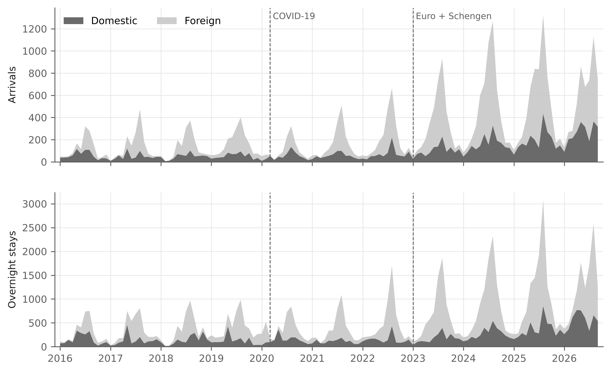
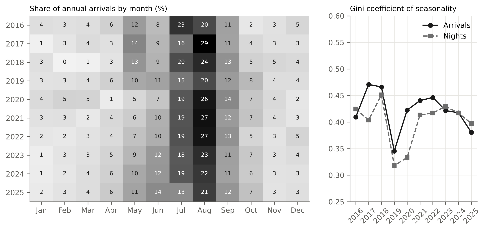
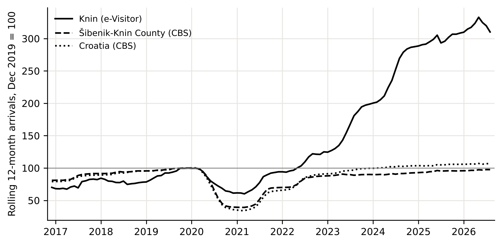
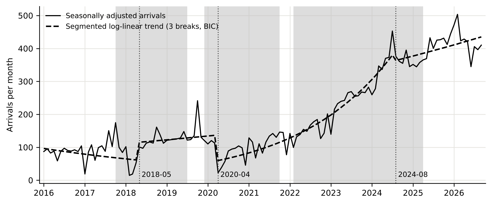
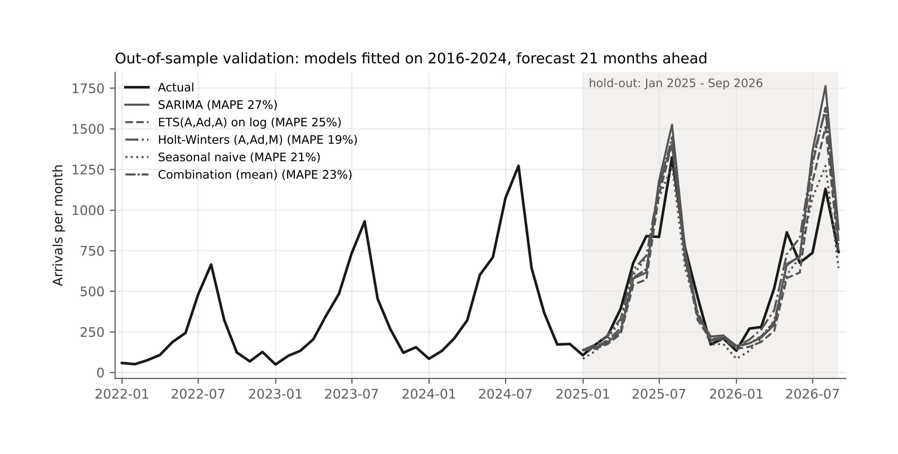
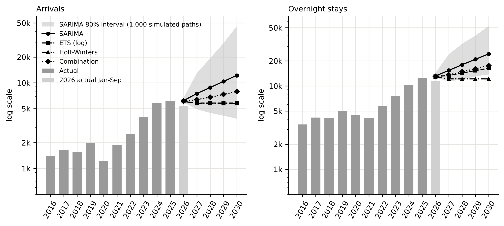

# INTRODUCTION

Croatian tourism is concentrated on the Adriatic coast, in space and in time. The coastal counties receive more than 90% of overnight stays, and the summer peak is among the most pronounced in Europe (Duro & Turrión-Prats, 2019; Payne, Nazlioglu, et al., 2023). National and regional strategies name the dispersion of demand towards the hinterland and the off-season as goals, but progress is usually assessed at county or national level, where small inland destinations are invisible. This paper looks at one such destination, the town of Knin in Šibenik-Knin County, over the first decade of the national e-Visitor registration system.

Knin, a town of about 11,000 inhabitants 55 km inland from Šibenik, lies on the main road and railway corridor between Zagreb and Split and close to the northern entrance of Krka National Park. Its offer rests on the Knin Fortress, the source of the river Krka, the Dinara nature park and the proximity of the Krka and Plitvice national parks. In the typology of visitor movement (Lew & McKercher, 2006), Knin has been an en-route stop rather than a base: visitors pass through on the way to the coast, stay one or two nights and move on. The Institute for Tourism's capacity study for the county identified the hinterland cluster, to which Knin belongs, as the cluster with the largest unused growth potential (Institut za turizam, 2019). The question addressed here is whether the decade 2016-2026 shows that potential being realised and whether growth changed the character of the destination.

The material is the complete monthly e-Visitor record for the area of the Knin tourist board from January 2016, when the system was introduced, to September 2026: 129 monthly observations of arrivals and overnight stays by country of origin for 75 reported markets. e-Visitor is the mandatory national register of tourist arrivals and the source of official statistics (Marušić et al., 2020). To the authors' knowledge, no peer-reviewed study has analysed tourism in Knin.

The paper addresses four research questions. RQ1: How much did tourism in Knin grow between 2016 and 2026, and did the growth path change in a statistically identifiable way around the COVID-19 pandemic and the 2023 adoption of the euro and entry into Schengen? RQ2: Did growth reduce the seasonal concentration of demand, in particular by spreading demand into the off-season? RQ3: How did the source-market structure change, and did diversification across markets go together with longer stays? RQ4: What range of arrivals and overnight stays do validated univariate forecasting models imply for 2030, and how reliable are such forecasts at the current turning point? The corresponding expectations, drawn from the literature reviewed in Section 1, are that growth after the pandemic followed a steeper path than before (H1), that growth spread demand into the off-season and lowered the Gini coefficient (H2), that diversification across markets was accompanied by longer stays (H3), and that damped and trend-extrapolating models diverge at a turning point (H4). Data, code and figures are published in an open repository.

The rest of the paper is structured as follows. Section 1 reviews the literature on tourism demand forecasting, seasonality, source-market concentration and structural change. Section 2 describes the data and methods. Section 3 presents the results and Section 4 discusses them. The conclusion summarises the findings and their implications.

# 1. LITERATURE REVIEW

## 1.1. Tourism demand forecasting

Tourism demand forecasting is a mature field (Song & Li, 2008; Wu et al., 2017; Song et al., 2019). For small destinations with short monthly series and no local explanatory variables at monthly frequency, univariate time-series models remain the practical choice. The tourism forecasting competition of Athanasopoulos et al. (2011) found that seasonal exponential smoothing (ETS) and seasonal ARIMA models perform well on monthly tourism series, that seasonal naive forecasts are hard to beat at short horizons, and that combinations are robust. These findings motivate the model set used here. Accuracy is assessed with the scale-free measures of Hyndman and Koehler (2006), and seasonality is treated as stochastic rather than deterministic (Kulendran & Wong, 2005). For Croatia, Baldigara and Mamula (2015) and Apergis et al. (2017) forecast arrivals with seasonal ARIMA models et al. (2015) compared univariate and causal models of inbound demand, and Gil-Alana et al. (2015) showed that Croatian monthly series are highly persistent. All of these studies work at national or county level; none forecasts a single small destination.

## 1.2. Seasonality and source markets

Seasonality is the most studied structural feature of tourism demand (Butler, 2001; Koenig-Lewis & Bischoff, 2005). Lundtorp (2001) distinguished amplitude measures (seasonality ratio, peak share) from concentration measures (coefficient of variation, Gini coefficient). The Gini coefficient of monthly values became the standard concentration measure after Fernández-Morales (2003) showed that it can be decomposed by source market (Fernández-Morales et al., 2016; Duro, 2016). Duro and Turrión-Prats (2019) found Croatia among the most seasonal destinations worldwide; Croatian studies confirmed this at national and county level (Kožić et al., 2013; Ružić & Gavrić, 2026), and Payne, Gil-Alana, et al. (2023) found that the pandemic changed the seasonality of coastal county series. Policy responses have focused on season extension through winter products (Krstinić Nižić & Šverko Grdić, 2018), agrotourism (Košak & Lugomer, 2016) and year-round rural experiences for domestic visitors (Pranić & Vuković, 2026), and Krešić (2026) showed that off-season visitors are at least as satisfied as summer visitors. Source-market concentration, measured by the Herfindahl-Hirschman index (HHI), affects the level and volatility of tourism revenues (Ağazade, 2022; Ağazade et al., 2023) and is linked to seasonality because different markets travel in different months, which is why this paper presents market-by-season flows jointly.

## 1.3. Structural change and hinterland tourism

The COVID-19 pandemic was the largest shock to tourism in the post-war period (Gössling et al., 2021; Škare et al., 2021), with recovery following different paths across destinations (Zhang et al., 2021). Payne et al. (2022) found that Croatian tourism series changed persistence after the pandemic, and Mikulić et al. (2023) showed that the pandemic hit Adriatic Croatia much harder than continental Croatia. Structural change is tested with the Chow (1960) test when the break date is known and estimated with the Bai and Perron (1998, 2003) procedure when it is not. Croatia's EU accession had a measurable effect on tourism (Tkalec, 2024); the 2023 adoption of the euro and entry into Schengen may have had similar effects, but no study has quantified this for a destination. The closest evidence is geographical: Opačić and Banda (2025) showed how the Pelješac bridge and Schengen altered tourism on the Pelješac peninsula, and Wittmann et al. (2026) traced a border region's transformation after Schengen accession. Growth paths are also read through the tourism area life cycle (Butler, 1980), formalised as a logistic curve by Lundtorp and Wanhill (2001).

Croatian tourism is spatially concentrated on the coast and regional convergence has been slow (Payne, Nazlioglu, et al., 2023). Studies of the Dalmatian hinterland are few. Protega et al. (2007) examined the effect of the A1 motorway on tourism in Šibenik-Knin County; Radeljak Kaufmann (2020) found spillovers from Krka National Park to surrounding municipalities; Telbisz et al. (2022) surveyed Krka visitors, most of whom are coastal tourists on a day trip; Petrić et al. (2025) proposed cultural tourism villages as a development model for the hinterland; and Cerjak et al. (2026) analysed cultural heritage as a driver of rural tourism in Šibenik-Knin County. Opačić et al. (2022) placed inland towns such as Knin in the lowest categories of their tourism development index. This paper adds a quantitative, decade-long case study to this thin literature.

# 2. DATA AND METHODS

## 2.1. Data

The data are monthly reports exported from e-Visitor by the Tourist Board of the City of Knin (area "Šibensko-kninska - Knin", all accommodation types, tourists only, all billing categories), listing arrivals, overnight stays and number of tourists by country of origin according to the classification of the Croatian Bureau of Statistics. Reports cover January 2016 to September 2026 (129 months); annual reports for 2016-2025 were used to check the monthly totals. Two problems were resolved. Several files were mislabelled, so the month of each file was taken from the date parameters stored inside the file. No valid export existed for May 2017; its values were reconstructed per country as the difference between the 2017 annual report and the other eleven months, which reproduces the annual totals exactly. For comparison with the county and national level, monthly arrivals and overnight stays in commercial accommodation for Šibenik-Knin County and Croatia (Croatian Bureau of Statistics, table BS_TU12, January 2016 to August 2026) were retrieved through the PxWeb API; these series exclude non-commercial accommodation, so levels are not directly comparable with the Knin series, but growth rates are. As an administrative register, e-Visitor under-records non-commercial stays and compliance improved in its first years (Marušić et al., 2020), which affects levels more than growth rates and seasonal patterns.

## 2.2. Methods

Annual arrivals, overnight stays, the foreign share and average length of stay (ALOS) are tabulated with compound annual growth rates (CAGR); 2026 is compared with the same months of 2025. Log-transformed monthly series were decomposed with robust STL (Cleveland et al., 1990), and the strength of trend and seasonality was computed as F_T = 1 - Var(R)/Var(T+R) and F_S = 1 - Var(R)/Var(S+R) (Hyndman & Athanasopoulos, 2021). For each complete year, seasonality was measured by the Gini coefficient of the twelve monthly values, the seasonality ratio, the July-August share and the November-March share, and trends were tested with Kendall's tau. For each year the HHI of arrivals across all and across foreign markets, the effective number of markets (1/HHI) and the top-five share were computed; market-by-season flows for 2023-2026 were drawn as a chord diagram.

Structural change was examined on seasonally adjusted log arrivals (log series minus the STL seasonal component). Because the series trends, breaks were not estimated in the mean but in a segmented trend model with segment-specific intercept and slope: break dates for one to three breaks were estimated by dynamic programming with a minimum segment of 18 months, the exact algorithm of Bai and Perron (2003), and the number of breaks was selected by the BIC. The significance of a single break was tested with a supF statistic over the trimmed sample, with the p-value obtained from a sieve bootstrap under the null of no break (499 replications, AR(2) errors), and 90% confidence intervals for the break dates were obtained from a parametric bootstrap of the selected segmented model (299 replications). As a complementary check, breaks in the growth rate itself were estimated on the first difference of the adjusted series. Chow (1960) tests at March 2020, June 2021 and January 2023 are reported for comparison with the a priori dates but, on a trending series, they are expected to reject and are not used for inference. To test whether the Knin path is specific to Knin rather than a reflection of regional or national demand, the Knin series was indexed against the county and national series, and the log ratio of Knin to county arrivals was regressed on time for 2016-2019 and 2021-2025.

Four models were fitted to monthly arrivals and overnight stays: a seasonal ARIMA(p,1,q)(P,1,Q)~12~ on the log scale with orders selected by the AIC under stationarity and invertibility constraints and residuals checked with the Ljung-Box test; an ETS(A,A~d~,A) model on the log scale; the Holt-Winters method with damped additive trend and multiplicative seasonality; the seasonal naive benchmark; and the mean of the first three as a combination. Two validation designs were used. First, models were estimated on January 2016 to December 2024 and evaluated on the 21-month hold-out from January 2025 to September 2026 with MAPE, RMSE, MASE and cumulative bias (Hyndman & Koehler, 2006). Second, because a single split at a turning point depends on that split, a rolling-origin evaluation (time-series cross-validation; Hyndman & Athanasopoulos, 2021) was run for arrivals with 45 monthly origins from January 2022 to September 2025, refitting every model at each origin and scoring horizons 1 to 12 months. Final projections refit each model on the full sample and forecast to December 2030; annual totals for 2026 combine observed January-September values with forecasts for October-December. Prediction intervals for annual sums were obtained by simulating 1,000 sample paths from the SARIMA models and taking the 10th and 90th percentiles of the annual totals, since summing monthly quantiles would overstate the width. All computations were done in Python 3.13 (pandas, statsmodels, ruptures, SciPy, pyCirclize); code and data are available in the repository cited at the end.

# 3. RESULTS

## 3.1. Growth 2016-2026

Table 1 and Figure 1 summarise the decade. Arrivals grew from 1,404 in 2016 to 6,178 in 2025 and overnight stays from 3,456 to 12,558, CAGRs of 17.9% and 15.4%. Growth was not uniform: arrivals rose 43% from 2016 to 2019; 2020 brought a 39% fall in arrivals but only an 11% fall in overnight stays, because the few visitors stayed longer (ALOS 3.6 nights); 2021-2025 was a period of rapid expansion (arrivals +34.5% per year, overnight stays +31.8%), with the largest increases in 2023 (+59%) and 2024 (+45%). Growth decelerated to +7% arrivals in 2025 and stopped in 2026: arrivals in January-September 2026 were 5,346, 0.2% above the same months of 2025, and overnight stays 11,328, 4.6% above. The foreign share of arrivals rose from 49% in 2016 to 63-69% in 2019-2025 and fell back to 57% in 2026 as domestic arrivals grew 31% year on year while foreign arrivals fell 15%. ALOS fell from 2.5-2.6 nights in 2016-2018 to 1.8-2.0 in 2023-2025: growth came from more, shorter visits.

**Table 1: Annual tourist arrivals and overnight stays in Knin, 2016-2026**

| Year | Arrivals | Overnight stays | Foreign share of arrivals (%) | ALOS (nights) | Arrivals y/y (%) | Nights y/y (%) |
|----------------------|--------:|--------:|--------:|--------:|--------:|--------:|
| 2016 | 1,404 | 3,456 | 49.4 | 2.46 | - | - |
| 2017 | 1,645 | 4,177 | 64.9 | 2.54 | +17.2 | +20.9 |
| 2018 | 1,565 | 4,129 | 62.4 | 2.64 | -4.9 | -1.1 |
| 2019 | 2,003 | 4,964 | 67.7 | 2.48 | +28.0 | +20.2 |
| 2020 | 1,227 | 4,432 | 52.2 | 3.61 | -38.7 | -10.7 |
| 2021 | 1,886 | 4,157 | 65.5 | 2.20 | +53.7 | -6.2 |
| 2022 | 2,503 | 5,755 | 66.7 | 2.30 | +32.7 | +38.4 |
| 2023 | 3,977 | 7,566 | 68.9 | 1.90 | +58.9 | +31.5 |
| 2024 | 5,758 | 10,236 | 67.2 | 1.78 | +44.8 | +35.3 |
| 2025 | 6,178 | 12,558 | 63.3 | 2.03 | +7.3 | +22.7 |
| 2026 (Jan-Sep) | 5,346 | 11,328 | 56.5 | 2.12 | +0.2* | +4.6* |

::: {custom-style="Source"}
Source: Authors' calculation from e-Visitor data. \* January-September 2026 against January-September 2025. ALOS = average length of stay.
:::

**Figure 1: Monthly tourist arrivals and overnight stays in Knin, January 2016 to September 2026**

::: {custom-style="Source"}
Source: Authors' calculation from e-Visitor data.
:::

The STL decomposition separates a strong trend (F_T = 0.75 for arrivals, 0.67 for overnight stays) from a strong, stable seasonal component (F_S = 0.82 and 0.81) whose amplitude implies an August level about thirteen times the February level once the trend is removed. The log series is non-stationary in levels (ADF with constant and trend, AIC lag selection, p = 0.68; KPSS with trend, automatic bandwidth, p = 0.10) and stationary after one regular and one seasonal difference (ADF p < 0.001), which supports the differencing structure of the SARIMA models.

## 3.2. Seasonality

The Gini coefficient of monthly arrivals ranged from 0.345 (2019) to 0.471 (2017), with 0.409 in 2016 and 0.381 in 2025; neither Kendall's tau (-0.29, p = 0.29) nor an OLS slope (p = 0.47) indicates a significant trend, although with ten annual observations these tests have little power and can only rule out large changes, and the coefficient for overnight stays moved from 0.424 to 0.397 (tau = 0.02). The July-August share of arrivals fell from 43% in 2016 and 46% in 2021-2022 to 35% in 2025, and the seasonality ratio from 3.2 to 2.6. Figure 2 shows where the peak share went: to May, June and September, each of which gained two to four percentage points. The winter share (November-March) did not increase; it fell from 18% to 14%, and winter arrivals grew more slowly (CAGR 14.8%) than June-September arrivals (17.6%). Domestic demand is much less seasonal (Gini 0.23-0.32 in every year except 2020) than foreign demand (0.42-0.61).

**Figure 2: Share of annual arrivals by month (left) and Gini coefficient of seasonality (right), Knin 2016-2025**

::: {custom-style="Source"}
Source: Authors' calculation from e-Visitor data.
:::

## 3.3. Source-market structure

Table 2 lists the ten largest markets. Croatia remained the largest market but its share fell from 51% to 37%; Germany rose from 4% to 11% and became the largest foreign market from 2019. Between 2019 and 2025 the fastest-growing markets were Austria (CAGR 36%), Slovenia (33%), Czechia (27%), Serbia (26%) and Germany (24%); markets prominent in 2016 because of single organised groups (Romania, Latvia, Belarus) disappeared. ALOS differs sharply by market: Serbian visitors stayed 3.7 nights in 2025, while Italian (1.2), Czech (1.4) and Slovenian (1.4) visitors were almost pure transit traffic. Concentration is low: the HHI across all markets fell from 0.272 in 2016 to 0.12-0.16 in 2022-2025, the HHI across foreign markets stayed between 0.058 and 0.082 (12-17 effective foreign markets) with no trend (tau = 0.16, p = 0.60), the top-five share fell from 71% to 57-63%, and the number of markets with at least one arrival rose from 38 to 59-60.

**Table 2: Ten largest source markets by arrivals, 2016-2025**

| Market | 2016 | 2019 | 2025 | Share 2016 (%) | Share 2025 (%) | CAGR 2019-2025 (%) | ALOS 2025 |
|----------------------|--------:|--------:|--------:|--------:|--------:|--------:|--------:|
| Croatia | 710 | 647 | 2,270 | 50.6 | 36.7 | 23.3 | 1.93 |
| Germany | 56 | 193 | 686 | 4.0 | 11.1 | 23.5 | 1.85 |
| Serbia | 32 | 93 | 370 | 2.3 | 6.0 | 25.9 | 3.74 |
| Poland | 22 | 91 | 307 | 1.6 | 5.0 | 22.5 | 1.78 |
| France | 23 | 135 | 276 | 1.6 | 4.5 | 12.7 | 1.54 |
| Bosnia and Herzegovina | 53 | 103 | 245 | 3.8 | 4.0 | 15.5 | 2.39 |
| Czechia | 17 | 57 | 237 | 1.2 | 3.8 | 26.8 | 1.41 |
| Austria | 46 | 34 | 218 | 3.3 | 3.5 | 36.3 | 1.91 |
| Italy | 44 | 95 | 189 | 3.1 | 3.1 | 12.1 | 1.16 |
| Slovenia | 25 | 32 | 176 | 1.8 | 2.8 | 32.9 | 1.43 |

::: {custom-style="Source"}
Source: Authors' calculation from e-Visitor data.
:::

Table 3 shows the seasonal distribution of each of the ten largest markets for 2023 to September 2026. Croatian demand is spread over all seasons, with 27% of arrivals in November-March. Every foreign market is dominated by June-August, from 44% for Bosnia and Herzegovina and Slovenia to 71% for Italy. The shoulder seasons are served mainly by Slovenia, Austria, Germany and Poland in April-May and by Germany in September-October; winter foreign demand is negligible except from Bosnia and Herzegovina (19%) and Serbia (11%), whose winter arrivals reflect family and business ties. In January-September 2026 all six largest foreign markets were below 2025 (Germany -30%, France -39%, Bosnia and Herzegovina -28%, Serbia -21%, Austria -14%, Poland -8%); of the larger markets only Croatia (+31%), Slovenia (+30%) and the Netherlands (+11%) grew.

**Table 3: Seasonal distribution of arrivals by source market, January 2023 to September 2026 (% of the market's arrivals)**

| Market | Nov-Mar | Apr-May | Jun-Aug | Sep-Oct | Arrivals 2023-2026 |
|----------------------|--------:|--------:|--------:|--------:|--------:|
| Croatia | 26.7 | 18.1 | 37.1 | 18.0 | 7,716 |
| Germany | 4.5 | 21.6 | 52.8 | 21.2 | 2,088 |
| Serbia | 10.6 | 17.1 | 61.6 | 10.6 | 1,108 |
| Poland | 4.1 | 20.8 | 59.8 | 15.2 | 1,063 |
| France | 2.8 | 15.2 | 65.4 | 16.5 | 991 |
| Czechia | 3.7 | 20.2 | 60.0 | 16.0 | 835 |
| Slovenia | 9.4 | 28.3 | 43.5 | 18.8 | 711 |
| Italy | 7.5 | 11.0 | 71.1 | 10.4 | 709 |
| Austria | 4.3 | 25.7 | 51.6 | 18.4 | 680 |
| Bosnia and Herzegovina | 18.5 | 18.6 | 43.8 | 19.1 | 676 |
| Other markets | 5.4 | 16.2 | 60.7 | 17.6 | 4,682 |
| All markets | 13.7 | 18.4 | 50.5 | 17.4 | 21,259 |

::: {custom-style="Source"}
Source: Authors' calculation from e-Visitor data.
:::

## 3.4. Structural change

Figure 3 shows the seasonally adjusted series with the segmented log-linear trend. The BIC selects three breaks, dated May 2018, April 2020 and August 2024, but the improvement over one break is small (BIC -250.8 against -247.1 for one break and -212.2 for none). The four segments have annual trend growth of -18%, 9%, 54% and 9%: a declining start from a very small base, modest growth to the pandemic, a steep segment from April 2020 to August 2024 and a near plateau since. The bootstrap 90% confidence intervals for the break dates are wide, 2017-10 to 2019-07, 2019-12 to 2021-10 and 2022-02 to 2025-04, so the third break cannot be placed more precisely than "between early 2022 and early 2025". The supF test for a single break in the trend model is maximised in April 2020 (F = 29.2) with a bootstrap p-value of 0.054, marginal at the 5% level. Breaks in the growth rate itself are not supported: on the first difference of the adjusted series the BIC prefers no break (mean growth 15.5% per year over the whole sample), and the one- to three-break alternatives have higher BIC values. Chow tests at March 2020, June 2021 and January 2023 all reject (F = 28.1, 18.4 and 17.9, p < 0.001), as expected on a trending series, and are not informative about the timing. Pre- and post-pandemic trend growth, estimated by OLS on 2016-2019 and on June 2021 to September 2026, was 16.8% and 32.7% per year.

The evidence for H1 is therefore qualified. A steeper post-pandemic segment is present in the fitted trend and in the OLS growth rates, but its start cannot be dated to a particular event, the single most prominent break in the trend model coincides with the pandemic trough rather than with 2023, and the growth rate shows no statistically distinct regime. The 2022-2024 acceleration is visible but is better described as a sustained episode within a volatile growth process than as a discrete regime shift. The comparison with official county and national series (Figure 4) shows that the Knin path is not a reflection of regional or national demand. Between 2019 and 2025 arrivals in commercial accommodation fell 4.3% in Šibenik-Knin County and rose 5.8% in Croatia, while arrivals in Knin rose 208%; between 2022 and 2025 the figures are +9.1%, +16.5% and +147%. Knin's share of county arrivals rose from 0.20% in 2019 to 0.64% in 2025. The log ratio of Knin to county arrivals grew 3.5% per year in 2016-2019 (p = 0.48) and 28.7% per year in 2021-2025 (p = 0.008). In January-August 2026 Knin (+0.8%), the county (+2.3%) and Croatia (+1.6%) all stagnated. The acceleration is therefore local; what the data cannot do is attribute it to the euro and Schengen rather than to local supply or marketing, because all three changed in the same years.

**Figure 4: Rolling 12-month arrivals, Knin (e-Visitor) against Šibenik-Knin County and Croatia (Croatian Bureau of Statistics, commercial accommodation), December 2019 = 100**

::: {custom-style="Source"}
Source: Authors' calculation from e-Visitor data and Croatian Bureau of Statistics table BS_TU12.
:::

**Figure 3: Seasonally adjusted arrivals with segmented log-linear trend, estimated break dates and bootstrap 90% confidence intervals (shaded)**

::: {custom-style="Source"}
Source: Authors' calculation. Breaks estimated by dynamic programming in a segmented trend model (Bai & Perron, 2003); three breaks selected by BIC.
:::

## 3.5. Forecasting models, validation and projections

The AIC selected SARIMA(0,1,2)(0,1,1)~12~ for log arrivals (Ljung-Box p = 0.84 at lag 12) and SARIMA(1,1,1)(1,1,1)~12~ for log overnight stays (p = 0.28), both close to the airline model with no remaining autocorrelation. The ETS models estimated a level smoothing parameter of 0.31-0.34, a trend smoothing parameter of zero and a damping parameter of 0.995. Table 4 reports the hold-out accuracy. For arrivals the Holt-Winters model had the lowest MAPE (18.9%), the seasonal naive benchmark the lowest MASE (1.50) and the ETS model the smallest bias (-3.6%); for overnight stays the ETS model had the lowest MAPE (24.8%) and all models under-predicted by 20-36%, because the 2025 season brought a 23% increase that no model fitted to 2016-2024 anticipated. All MASE values exceed one, which is expected for a 21-month horizon but also reflects the turning point in 2026: every model, including the seasonal naive benchmark, over-predicted June to August 2026, when arrivals fell 12-20% below 2025 after January-May had been 24-56% above (Figure 5).

**Table 4: Out-of-sample forecast accuracy, hold-out January 2025 to September 2026 (21 months)**

| Model | Arrivals MAPE (%) | Arrivals RMSE (arrivals/month) | Arrivals MASE | Arrivals bias (%) | Nights MAPE (%) | Nights RMSE (nights/month) | Nights MASE | Nights bias (%) |
|----------------------|--------:|--------:|--------:|--------:|--------:|--------:|--------:|--------:|
| SARIMA (log) | 26.9 | 236 | 2.23 | +7.8 | 27.0 | 371 | 2.15 | -24.0 |
| ETS(A,A~d~,A) (log) | 24.8 | 185 | 1.94 | -3.6 | 24.8 | 347 | 1.99 | -21.0 |
| Holt-Winters (A,A~d~,M) | 18.9 | 192 | 1.67 | +8.8 | 35.2 | 540 | 3.19 | -36.4 |
| Seasonal naive | 21.0 | 137 | 1.50 | -6.3 | 25.3 | 342 | 1.84 | -20.0 |
| Combination | 23.1 | 200 | 1.92 | +4.3 | 27.1 | 406 | 2.32 | -27.1 |

::: {custom-style="Source"}
Source: Authors' calculation. Bias = (sum of forecasts - sum of actuals) / sum of actuals.
:::

**Figure 5: Out-of-sample validation of monthly arrival forecasts, models fitted on 2016-2024**

::: {custom-style="Source"}
Source: Authors' calculation.
:::

The rolling-origin evaluation (Table 5) confirms that the single split is not an artefact. Across 45 origins and horizons 1 to 12, the seasonal naive benchmark has the lowest MASE (2.54) and MAPE (32.4%), followed by the combination (2.67; 34.4%), Holt-Winters, ETS and SARIMA (2.73; 34.6%). The model-based forecasts beat the benchmark only at horizons 5 to 8 months, where the ETS and combination forecasts are best; at horizons 1 to 4 and 9 to 12 the benchmark wins. MASE values above two at every horizon reflect the scale: the in-sample seasonal naive error comes mostly from the small, stable years before 2022. The practical reading is that no univariate model extracts much more than last year's seasonal pattern from a series of this size during a period of rapid change, which is consistent with the tourism forecasting competition (Athanasopoulos et al., 2011), and that combinations are a safe default.

**Table 5: Rolling-origin evaluation of arrival forecasts, MASE by forecast horizon (45 origins, January 2022 to September 2025)**

| Horizon (months) | SARIMA | ETS | Holt-Winters | Seasonal naive | Combination |
|----------------------|--------:|--------:|--------:|--------:|--------:|
| 1 | 2.63 | 2.82 | 2.71 | 2.29 | 2.69 |
| 2 | 2.72 | 2.87 | 2.80 | 2.42 | 2.77 |
| 3 | 2.62 | 2.74 | 2.60 | 2.47 | 2.64 |
| 4 | 2.61 | 2.67 | 2.63 | 2.55 | 2.62 |
| 5 | 2.50 | 2.41 | 2.46 | 2.60 | 2.45 |
| 6 | 2.49 | 2.33 | 2.46 | 2.64 | 2.40 |
| 7 | 2.63 | 2.56 | 2.72 | 2.63 | 2.61 |
| 8 | 2.77 | 2.68 | 2.83 | 2.67 | 2.72 |
| 9 | 2.66 | 2.59 | 2.65 | 2.46 | 2.60 |
| 10 | 2.79 | 2.68 | 2.71 | 2.43 | 2.68 |
| 11 | 3.08 | 2.85 | 2.78 | 2.59 | 2.87 |
| 12 | 3.21 | 3.06 | 2.85 | 2.71 | 2.99 |
| All horizons | 2.73 | 2.69 | 2.68 | 2.54 | 2.67 |

::: {custom-style="Source"}
Source: Authors' calculation. MASE scaled by the in-sample one-step seasonal naive error at each origin.
:::

Table 6 and Figure 6 present the projections from models refitted to September 2026. For 2026 the models agree: 6,100-6,200 arrivals and 13,000-13,200 overnight stays. Beyond 2026 they diverge. SARIMA, which extrapolates the average growth of the differenced series, projects 12,200 arrivals and 24,200 overnight stays in 2030, which would require a return to about 18% annual growth; the damped ETS and Holt-Winters models, whose trend is close to zero at the end of the sample, project a plateau of 5,800 arrivals and 12,100-16,300 overnight stays; the combination gives 7,900 arrivals and 17,600 overnight stays, about 6.5% and 7.5% annual growth. The simulated 80% interval of the SARIMA model for 2030 runs from 3,413 to 46,884 arrivals (median 13,033) and from 13,702 to 50,894 overnight stays; the interval is asymmetric because the model is estimated on the log scale, and its width illustrates the uncertainty of a four-year horizon for a series of this size. The lower bounds of both intervals lie below the 2025 level, so a decline by 2030 is within the 80% range.

**Table 6: Annual projections of arrivals and overnight stays to 2030**

| Year | Arrivals SARIMA | Arrivals ETS | Arrivals Holt-Winters | Arrivals combination | Arrivals 80% interval | Nights SARIMA | Nights ETS | Nights Holt-Winters | Nights combination |
|----------------------|--------:|--------:|--------:|--------:|--------:|--------:|--------:|--------:|--------:|
| 2026* | 6,198 | 6,073 | 6,068 | 6,113 | 5,904-6,730 | 13,165 | 13,033 | 12,810 | 13,003 |
| 2027 | 7,490 | 5,812 | 5,764 | 6,355 | 4,791-13,347 | 15,361 | 13,296 | 12,139 | 13,599 |
| 2028 | 8,818 | 5,812 | 5,764 | 6,798 | 4,354-20,154 | 17,952 | 14,293 | 12,139 | 14,795 |
| 2029 | 10,380 | 5,812 | 5,764 | 7,318 | 4,044-32,580 | 20,879 | 15,300 | 12,139 | 16,106 |
| 2030 | 12,219 | 5,812 | 5,764 | 7,931 | 3,413-46,884 | 24,247 | 16,312 | 12,139 | 17,566 |

::: {custom-style="Source"}
Source: Authors' calculation. \* Observed January-September plus forecast October-December. 80% interval from 1,000 simulated SARIMA paths.
:::

**Figure 6: Annual arrivals and overnight stays, actual 2016-2026 and projections to 2030 with simulated 80% intervals**

::: {custom-style="Source"}
Source: Authors' calculation.
:::

# 4. DISCUSSION

## 4.1. Growth and its drivers

The decade divides into three phases: slow growth to 2019 from a very low base, the pandemic interruption, and rapid expansion from mid-2021 to 2025 followed by a stall in 2026. The steep segment of the fitted trend runs from the pandemic trough to mid-2024 and covers the full reopening of European travel, Croatia's entry into the euro area and Schengen on 1 January 2023 and, possibly, growth in local accommodation supply, which the data do not record; but the break dates carry wide confidence intervals and the growth rate shows no statistically distinct regime, so the data describe an episode of fast growth rather than a dated regime shift. The Schengen effect should be strongest for transit traffic from Central Europe, because the removal of the Slovenian-Croatian border queue shortened the drive from Germany, Austria, Czechia and Poland, and those are the markets that grew fastest between 2019 and 2025; and the comparison with official statistics shows that the growth was specific to Knin: county arrivals were below their 2019 level in 2025 while Knin's had tripled. Schengen is a plausible contributor, but the same years saw growth in local supply that the data do not record, and a difference-in-differences design with inland towns in countries that did not join Schengen would be needed to separate the two.

The stall in 2026 deserves attention. Foreign arrivals in January-September fell 15% while domestic arrivals rose 31%; the decline was concentrated in June-August and in the German, French, Bosnian, Serbian and Italian markets, while the first five months of 2026 were still well above 2025. The pattern is consistent with the end of a catch-up phase in which the destination filled a gap in the market for inexpensive overnight stops on the way to the coast, and with the price-sensitivity of transit travellers after three years of strong price increases in Croatian tourism; a weaker summer on the coast in 2026 would produce the same signature, and the two cannot be separated without comparable data for other destinations. The simultaneous growth of domestic demand in every month of 2026 shows that the stall is specific to the foreign summer segment. The forecasting exercise makes the same point from another angle: models fitted to 2016-2024 over-predicted 2026 by every measure, because the information in the data up to 2024 was "growth continues" and the realised path in 2026 was "growth stops".

## 4.2. Seasonality and the transit character

The hypothesis that growth would spread demand into the off-season is not supported. The Gini coefficient did not fall significantly and the winter share fell; what changed is the shape of the summer, with the July-August share down eight to ten points and May, June and September up. This is the pattern of a destination whose growth comes from the same transit flows spread over a longer summer, not from new winter products. Compared with the coastal counties, whose seasonal concentration is among the highest in Europe (Kožić et al., 2013; Duro & Turrión-Prats, 2019), Knin is less seasonal, and its domestic demand is only moderately seasonal. The market-by-season decomposition shows that off-season growth, if it comes, will come from domestic visitors and the near markets, not from the Central European summer markets.

Knin's foreign demand is unusually diversified for a small destination, with 12-17 effective foreign markets and no foreign market above 11% of arrivals. The vulnerability lies elsewhere: seven of the ten largest markets stay less than two nights, and ALOS fell from 2.5 to 2.0 nights during the growth phase, so the new demand was even more transit-oriented than the old. In Lew and McKercher's (2006) terms, Knin grew as a node on the Zagreb-Split corridor, not as a base for exploring the hinterland; the visitor survey of Telbisz et al. (2022) shows the same pattern from the other side, with most Krka National Park visitors being coastal tourists on a day trip. The exceptions, Serbia (3.7 nights) and to a lesser extent Bosnia and Herzegovina and the United States, point to visiting-friends-and-relatives and heritage motives. The question in the title can therefore be answered: Knin became a much busier transit stop, but not yet a destination. The projection scenarios translate this into numbers: the plateau of the damped models (5,800 arrivals) is what the data imply if nothing changes, the SARIMA path (12,200) is what the pre-2026 growth rate would deliver if it resumed, and the combination (7,900) is a middle path. Converting a fraction of transit visitors into two- or three-night stays would raise overnight stays without any increase in arrivals and is the lever with the highest return, because it does not depend on attracting new markets.

## 4.3. Methodological notes and limitations

Three methodological points follow. The e-Visitor register gives a small destination a complete monthly census of registered tourists by market, a richer basis than survey statistics, at the price of sensitivity to early registration compliance and under-recording of non-commercial stays. The break analysis shows that for a destination like Knin the pandemic was a transient shock and the regime change came later; studies that test only for a 2020 break will misdate it. And at a turning point the disagreement between model families is informative in itself: the gap between trend-extrapolating and damped models measures how much the future depends on whether recent growth was structural or a one-off catch-up, and reporting the range is more useful to a destination manager than one number.

The study covers one destination and ten complete years, which limits the power of trend tests on annual indicators; a logistic life-cycle curve (Butler, 1980; Lundtorp & Wanhill, 2001) fitted to annual arrivals gave a carrying capacity whose standard error exceeded the estimate and is therefore not reported. The 2026 data cover nine months and may be revised. The analysis uses no explanatory variables, so it describes and extrapolates rather than explains; monthly data on accommodation capacity, prices, Krka National Park visitors and national arrivals would allow a causal design. Arrivals and overnight stays do not measure expenditure.

# CONCLUSION

The four research questions can be answered as follows. RQ1: tourism in Knin grew more than fourfold between 2016 and 2025 and stopped growing in 2026. A steeper post-pandemic trend is present (H1 partly supported), but its start cannot be dated to the pandemic, the euro or Schengen: break dates in the segmented trend have confidence intervals of two to three years, the single most prominent break coincides with the pandemic trough, and the growth rate shows no statistically distinct regime; the growth was, however, specific to Knin and not a reflection of county or national demand. RQ2: seasonality did not decrease; the Gini coefficient showed no significant trend, the summer peak flattened into a longer summer and the winter share fell (H2 rejected). RQ3: foreign demand diversified across 12-17 effective markets, but average length of stay fell to two nights, so diversification went together with shorter, not longer, stays (H3 rejected); the growth made Knin a busier transit stop rather than a destination. RQ4: validated models disagree at the turning point as expected (H4 supported), with a plateau at about 6,000 arrivals and 12,000-16,000 overnight stays if the 2026 stall persists, about 8,000 and 17,600 on the combined path and about 12,000 and 24,000 if the 2022-2025 growth resumes; rolling-origin evaluation shows that no model beats last year's seasonal pattern by much, so the range, not a point forecast, is the usable result.

For the local tourist board and the county, the practical implication is that length of stay and the shoulder seasons, not new source markets, are the margins on which the next phase of development will be decided. The data set and code are published so that the same analysis can be run for other Croatian local tourist boards and updated when the 2026 season closes.

# ACKNOWLEDGEMENTS

The authors thank the Tourist Board of the City of Knin for providing the e-Visitor exports. The consolidated data set, code and figures are available at https://github.com/vedranu/knin-evisitor-tourism.

# DECLARATION OF GENERATIVE AI AND AI-ASSISTED TECHNOLOGIES IN THE WRITING PROCESS

In preparing this paper, the authors used Claude (Anthropic) to improve the readability and language of the manuscript and to assist in writing and documenting the data-processing and statistical analysis code, which is published in full in the accompanying repository. All analyses were specified, reproduced and checked by the authors, and the tool was not used to generate findings, interpretations or conclusions. Following the use of this tool, the authors have reviewed and edited the content as necessary and take full responsibility for the content of the published article.

# REFERENCES

::: {custom-style="References"}
Ağazade, S. (2022). The effect of tourism source market structure on international tourism revenues in Turkey. *Tourism Economics, 28*(3), 714-727. https://doi.org/10.1177/13548166211055985

Ağazade, S., Tükenmez, E. G., & Uzun, M. (2023). Is the volatility of international tourism revenues affected by tourism source market structure? An empirical analysis of Turkey. *Tourism Economics, 29*(2), 291-304. https://doi.org/10.1177/13548166211046070

Apergis, N., Mervar, A., & Payne, J. E. (2017). Forecasting disaggregated tourist arrivals in Croatia. *Tourism Economics, 23*(1), 78-98. https://doi.org/10.5367/te.2015.0499

Athanasopoulos, G., Hyndman, R. J., Song, H., & Wu, D. C. (2011). The tourism forecasting competition. *International Journal of Forecasting, 27*(3), 822-844. https://doi.org/10.1016/j.ijforecast.2010.04.009

Bai, J., & Perron, P. (1998). Estimating and testing linear models with multiple structural changes. *Econometrica, 66*(1), 47-78. https://doi.org/10.2307/2998540

Bai, J., & Perron, P. (2003). Computation and analysis of multiple structural change models. *Journal of Applied Econometrics, 18*(1), 1-22. https://doi.org/10.1002/jae.659

Baldigara, T., & Mamula, M. (2015). Modelling international tourism demand using seasonal ARIMA models. *Tourism and Hospitality Management, 21*(1), 1-31. https://doi.org/10.20867/thm.21.1.2

Butler, R. W. (1980). The concept of a tourist area cycle of evolution: Implications for management of resources. *Canadian Geographer, 24*(1), 5-12. https://doi.org/10.1111/j.1541-0064.1980.tb00970.x

Butler, R. W. (2001). Seasonality in tourism: Issues and implications. In T. Baum & S. Lundtorp (Eds.), *Seasonality in tourism* (pp. 5-21). Pergamon. https://doi.org/10.1016/B978-0-08-043674-6.50005-2

Cerjak, M., Galić, G., & Antoniak, M. A. (2026). Cultural heritage as a driver of sustainable rural tourism development: A case study of Šibenik-Knin County. *Sustainability, 18*(3), 1416. https://doi.org/10.3390/su18031416

Chow, G. C. (1960). Tests of equality between sets of coefficients in two linear regressions. *Econometrica, 28*(3), 591-605. https://doi.org/10.2307/1910133

Cleveland, R. B., Cleveland, W. S., McRae, J. E., & Terpenning, I. (1990). STL: A seasonal-trend decomposition procedure based on loess. *Journal of Official Statistics, 6*(1), 3-73.

Duro, J. A. (2016). Seasonality of hotel demand in the main Spanish provinces: Measurements and decomposition exercises. *Tourism Management, 52*, 52-63. https://doi.org/10.1016/j.tourman.2015.06.013

Duro, J. A., & Turrión-Prats, J. (2019). Tourism seasonality worldwide. *Tourism Management Perspectives, 31*, 38-53. https://doi.org/10.1016/j.tmp.2019.03.010

Fernández-Morales, A. (2003). Decomposing seasonal concentration. *Annals of Tourism Research, 30*(4), 942-956. https://doi.org/10.1016/S0160-7383(03)00090-2

Fernández-Morales, A., Cisneros-Martínez, J. D., & McCabe, S. (2016). Seasonal concentration of tourism demand: Decomposition analysis and marketing implications. *Tourism Management, 56*, 172-190. https://doi.org/10.1016/j.tourman.2016.04.004

Gil-Alana, L. A., Mervar, A., & Payne, J. E. (2015). Measuring persistence in Croatian tourism: Evidence from the Adriatic region. *Applied Economics, 47*(46), 4901-4917. https://doi.org/10.1080/00036846.2015.1037440

Gössling, S., Scott, D., & Hall, C. M. (2021). Pandemics, tourism and global change: A rapid assessment of COVID-19. *Journal of Sustainable Tourism, 29*(1), 1-20. https://doi.org/10.1080/09669582.2020.1758708

Hyndman, R. J., & Athanasopoulos, G. (2021). *Forecasting: Principles and practice* (3rd ed.). OTexts. https://otexts.com/fpp3/

Hyndman, R. J., & Koehler, A. B. (2006). Another look at measures of forecast accuracy. *International Journal of Forecasting, 22*(4), 679-688. https://doi.org/10.1016/j.ijforecast.2006.03.001

Institut za turizam. (2019). *Studija održivosti razvoja turizma i prihvatnog kapaciteta s akcijskim planom Šibensko-kninske županije*. Institut za turizam. https://repozitorij.iztzg.hr/islandora/object/iztzg:48

Koenig-Lewis, N., & Bischoff, E. E. (2005). Seasonality research: The state of the art. *International Journal of Tourism Research, 7*(4-5), 201-219. https://doi.org/10.1002/jtr.531

Košak, M., & Lugomer, K. (2016). Agroturizam u funkciji produljenja turističke sezone primorske Hrvatske. *Hrvatski geografski glasnik, 77*(2), 141-168. https://doi.org/10.21861/hgg.2015.77.02.07

Kožić, I., Krešić, D., & Boranić-Živoder, S. (2013). Analiza sezonalnosti turizma u Hrvatskoj primjenom metode Gini koeficijenta. *Ekonomski pregled, 64*(2), 159-181.

Krešić, D. (2026). Tourism seasonality and tourist satisfaction: Evidence from a year-round visitor survey in Croatia. *Tourism, 74*(3), 519-529. https://doi.org/10.37741/t.74.3.10

Krstinić Nižić, M., & Šverko Grdić, Z. (2018). Winter tourism in Croatia: Is it possible? *Sustainability, 10*(10), 3563. https://doi.org/10.3390/su10103563

Kulendran, N., & Wong, K. K. F. (2005). Modeling seasonality in tourism forecasting. *Journal of Travel Research, 44*(2), 163-170. https://doi.org/10.1177/0047287505276605

Lew, A., & McKercher, B. (2006). Modeling tourist movements: A local destination analysis. *Annals of Tourism Research, 33*(2), 403-423. https://doi.org/10.1016/j.annals.2005.12.002

Lundtorp, S. (2001). Measuring tourism seasonality. In T. Baum & S. Lundtorp (Eds.), *Seasonality in tourism* (pp. 23-50). Pergamon. https://doi.org/10.1016/B978-0-08-043674-6.50006-4

Lundtorp, S., & Wanhill, S. (2001). The resort lifecycle theory: Generating processes and estimation. *Annals of Tourism Research, 28*(4), 947-964. https://doi.org/10.1016/S0160-7383(00)00080-3

Marušić, Z., Kožul, M., & Brozović, I. (2020). Measuring non-commercial tourism traffic in Croatia: Challenges of using administrative data. *Croatian Review of Economic, Business and Social Statistics, 6*(2), 69-81. https://doi.org/10.2478/crebss-2020-0012

Mikulić, D., Keček, D., & Žajdela Hrustek, N. (2023). Effects of COVID-19 on Adriatic and continental Croatia tourism: A regional input-output perspective. *Economic Research-Ekonomska Istraživanja, 36*(2), 2142811. https://doi.org/10.1080/1331677X.2022.2142811

Opačić, V. T., & Banda, A. (2025). Utjecaj promjene geografskoga položaja na recentni turistički razvoj poluotoka Pelješca i obalnoga prostora uz zaljev Klek-Neum. *Hrvatski geografski glasnik, 87*(2), 137-167. https://doi.org/10.21861/HGG.2024.87.02.06

Opačić, V. T., Klarić, Z., Beroš, I., & Boranić Živoder, S. (2022). Tourism Development Index of local self-government units: The example of Croatia. *Acta geographica Slovenica, 62*(1), 77-87. https://doi.org/10.3986/ags.9814

Payne, J. E., Gil-Alana, L. A., & Mervar, A. (2022). Persistence in Croatian tourism: The impact of COVID-19. *Tourism Economics, 28*(6), 1676-1682. https://doi.org/10.1177/1354816621999969

Payne, J. E., Gil-Alana, L. A., Mervar, A., & Goenechea, M. (2023). Tourist arrivals and overnight stays along the Croatian Adriatic Coast: Changes in persistence and seasonality from the COVID-19 disruption. *Tourism Economics, 29*(6), 1679-1693. https://doi.org/10.1177/13548166221110528

Payne, J. E., Nazlioglu, S., & Mervar, A. (2023). Regional tourism convergence: A disaggregated analysis of Croatia. *Applied Economics, 55*(52), 6149-6169. https://doi.org/10.1080/00036846.2022.2141460

Petrić, L., Mandić, A., & Mikulić, D. (2025). Fostering sustainable and resilient rural communities through cultural tourism villages: A case study of the Dalmatian hinterland. In X. Matteucci & S. Moretti (Eds.), *The future of cultural tourism* (pp. 50-69). Channel View Publications.

Pranić, L., & Vuković, M. (2026). Beyond the summer: Identifying rural experiences for year-round domestic tourism in a seasonal destination. *Tourism Recreation Research, 51*(2), 515-532. https://doi.org/10.1080/02508281.2025.2489441

Protega, V., Božić, N., & Lučić, Z. (2007). Impact of motorway A1 on development of tourism in the Šibenik-Knin County. *Promet - Traffic & Transportation, 19*(4), 225-231.

Radeljak Kaufmann, P. (2020). Rural tourism in the surroundings of Krka National Park: Factors of development and spatial impacts. In M. Koderman & V. T. Opačić (Eds.), *Challenges of tourism development in protected areas of Croatia and Slovenia* (pp. 53-73). University of Primorska Press. https://doi.org/10.26493/978-961-7055-08-5.53-73

Ružić, I., & Gavrić, T. (2026). Regional determinants of tourism seasonality in Mediterranean EU NUTS-2 regions: A panel analysis using the Gini coefficient (2020-2024). *Tourism and Hospitality, 7*(8), 231. https://doi.org/10.3390/tourhosp7080231

Škare, M., Soriano, D. R., & Porada-Rochoń, M. (2021). Impact of COVID-19 on the travel and tourism industry. *Technological Forecasting and Social Change, 163*, 120469. https://doi.org/10.1016/j.techfore.2020.120469

Song, H., & Li, G. (2008). Tourism demand modelling and forecasting - A review of recent research. *Tourism Management, 29*(2), 203-220. https://doi.org/10.1016/j.tourman.2007.07.016

Song, H., Qiu, R. T. R., & Park, J. (2019). A review of research on tourism demand forecasting. *Annals of Tourism Research, 75*, 338-362. https://doi.org/10.1016/j.annals.2018.12.001

Telbisz, T., Šulc, I., Mari, L., & Radeljak Kaufmann, P. (2022). Attitudes and preferences of visitors of Krka National Park, Croatia. *Hungarian Geographical Bulletin, 71*(2), 117-132. https://doi.org/10.15201/hungeobull.71.2.2

Tica, J., & Kožić, I. (2015). Forecasting Croatian inbound tourism demand. *Economic Research-Ekonomska Istraživanja, 28*(1), 1046-1062. https://doi.org/10.1080/1331677X.2015.1100842

Tkalec, M. (2024). The effect of EU membership on tourism in Croatia. *European Journal of Tourism Research, 37*, 3708. https://doi.org/10.54055/ejtr.v37i.3342

Wittmann, T., Gonda, T., Merza, P., & Pap, N. (2026). From closed border to tourism destination: The Baranja triangle's transformation from Trianon to Schengen. *GeoJournal of Tourism and Geosites, 67*(3), 1926-1935. https://doi.org/10.30892/gtg.67309-1821

Wu, D. C., Song, H., & Shen, S. (2017). New developments in tourism and hotel demand modeling and forecasting. *International Journal of Contemporary Hospitality Management, 29*(1), 507-529. https://doi.org/10.1108/IJCHM-05-2015-0249

Zhang, H., Song, H., Wen, L., & Liu, C. (2021). Forecasting tourism recovery amid COVID-19. *Annals of Tourism Research, 87*, 103149. https://doi.org/10.1016/j.annals.2021.103149
:::

+---------------------------------------------------------------------------------------------------------------------------------------------------------------------------------------------------------------------------------------------------------------------------------------------------------------------------------------------------------------------------------------------------------------------------------------------------------------------------------------+
| **Vedran Uroš** is a senior lecturer at the University of Applied Sciences "Marko Marulić" in Knin, where he is acting vice-dean for research and international cooperation, and a doctoral candidate at the Faculty of Organization and Informatics, University of Zagreb. His research covers energy-efficient wireless sensor networks and UAV-assisted data collection, as well as applied data analysis in tourism and regional development. [complete to 100 words]           |
+---------------------------------------------------------------------------------------------------------------------------------------------------------------------------------------------------------------------------------------------------------------------------------------------------------------------------------------------------------------------------------------------------------------------------------------------------------------------------------------+
| **[Co-author Sorić]** [biography of no more than 100 words to be added]                                                                                                                                                                                                                                                                                                                                                                                                                 |
+---------------------------------------------------------------------------------------------------------------------------------------------------------------------------------------------------------------------------------------------------------------------------------------------------------------------------------------------------------------------------------------------------------------------------------------------------------------------------------------+
